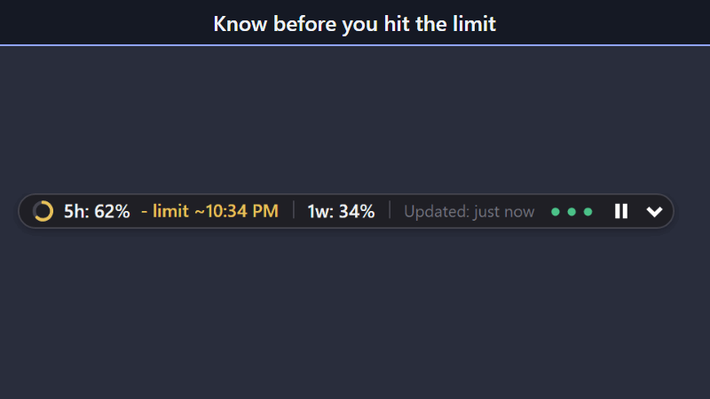
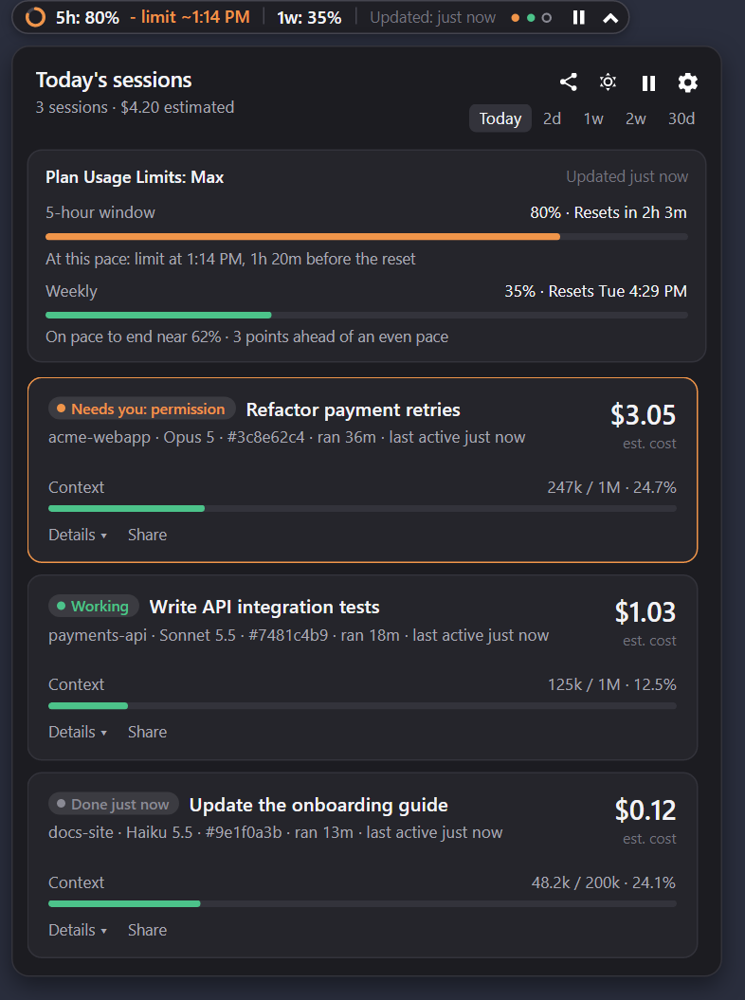
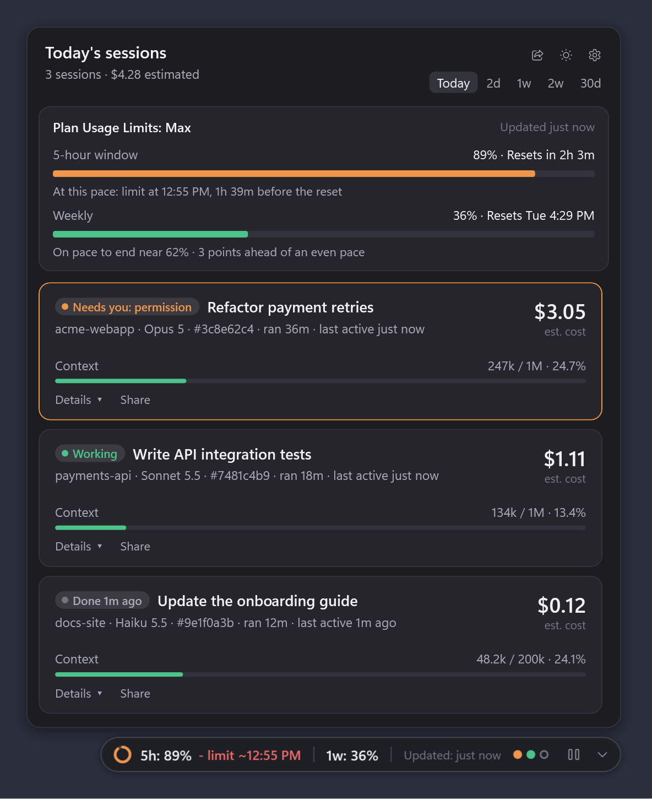
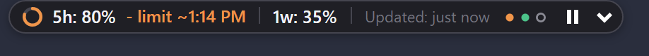
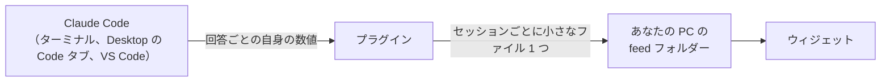
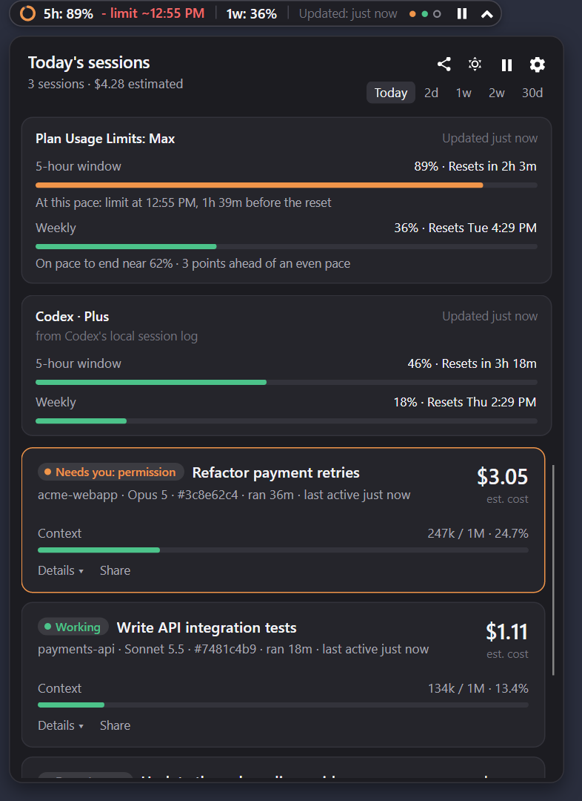
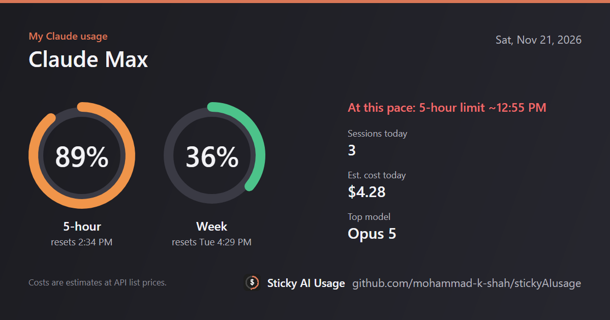

<div align="center">


# Sticky AI Usage

**上限に達する前に知る。**<br/>
Claude Code の使用上限、今のペースで上限に達する時刻、そしてどのセッションがあなたを待っているかを、Windows のタスクバーや Mac のメニューバーに表示します。データは Claude Code 自身から直接受け取ります。

[English](README.md) · [简体中文](README.zh-CN.md) · **日本語** · [한국어](README.ko.md)

<sub>これは 2026-11-23 時点の英語版 README の翻訳です。内容が異なる場合は[英語版 README](README.md) が基準です。ネイティブの方の修正を歓迎します。</sub>

⭐ **上限で作業が止まるのを防げたら、Star をお願いします。**

<sub>独立したオープンソースプロジェクトです。Anthropic とは提携しておらず、承認も受けていません。</sub>

<br/>



</div>

**1 行でインストール**（詳細やほかの方法は英語版の [Install](README.md#-install)）：

```text
Windows   irm https://raw.githubusercontent.com/mohammad-k-shah/stickyAIusage/main/scripts/install.ps1 | iex
macOS     curl -fsSL https://raw.githubusercontent.com/mohammad-k-shah/stickyAIusage/main/scripts/install.sh | sh
Plugin    /plugin install sticky-usage --marketplace mohammad-k-shah/stickyAIusage      （Claude Code 内で）
```

初回起動時、ウィジェットがプラグインの接続を手伝います。Claude Code のコマンドラインがあればワンクリック、なければ貼り付ける 1 行をコピーできます。

<p align="center"></p>

---

## ⏱️ 上限に達する前に知る

ウィジェットは 5 時間枠と週の枠（または月の支出上限）を常に表示します。作業中は使用量の増え方を見ていて、今のペースだと 5 時間の上限がリセットより先に来る場合、カウントダウンが到達予定時刻（例："limit ~1:36 PM"）に変わり、1 時間以内でオレンジ、30 分以内で赤になります。枠がオレンジや赤になったとき、上限まで 30 分になったとき、上限に達したとき、枠がリセットされたとき（"You're back"）に、それぞれ 1 回だけ通知します。同じ通知は繰り返しません。おやすみ時間と 1 時間のミュートもあります。

<p align="center"></p>

## 🚦 どのエージェントがあなたを待っているか知る

実行中の Claude Code セッションごとにウィジェットにドットが付きます。あなたを待っているとき（許可、質問、MCP サーバーへの入力）は**琥珀色**、作業中は**緑**、完了したら**グレー**です。20 秒待っているセッションがあれば、どれかを 1 回通知します。パネルでは待っているセッションが先頭に並びます。

<p align="center"></p>

## 🤝 エージェントにも知らせる

同じプラグインは Claude Code の中でも動きます（ウィジェットがなくても）：`/pace`、上限が近いときにプロンプトの上に出る 1 行、Claude が長い作業や並列作業の前に呼び出すツール、そして上限が近いときにサブエージェントを始める前に一度だけ確認する予算ガード（そのまま実行、Haiku を使う、スキップ）です。

```text
/pace
5-hour: 43% used · resets 4:30 PM · at this pace: limit ~4:12 PM
Week:   14% used · resets Fri 3:30 PM · under an even pace
Session: context 24% · cost $3.05

● 5h 89% · limit ~3:27 PM · week 36%          ← 上限の半分を使うとプロンプトの上に表示
```

## 🔑 数値の出どころ



| 表示されるもの | 出どころ | 信頼度 | PC の外に出るか |
|---|---|---|---|
| 5 時間・週・支出の上限とリセット | 回答ごとに Claude Code がプラグインに渡す自身の数値 | 公式（Claude Code の公開インターフェース） | いいえ |
| どのセッションが作業中か、待っているか | 同じプラグインを通した Claude Code のイベント | 公式 | いいえ |
| セッションの費用、トークン、コンテキスト、モデル | PC 上の Claude Code のセッションファイル（またはプラグイン経由の Claude Code 自身の数値） | 推定（ローカルファイル） | いいえ |
| 今のペースでの上限到達時刻 | 上の数値から PC 上で計算 | 推定であることを明示 | いいえ |
| Codex の上限（Codex を使う場合） | PC 上の Codex 自身のセッションログ | 推定 | いいえ |

**初期設定では、Claude のサインイン情報を読まず、ネットワーク通信もしません。** 設定 → **Usage source** には **Automatic** と **Legacy** もあり、Claude Code が保存したサインイン情報を読んで Anthropic の使用量サービスに問い合わせます（ドル建ての月の支出上限やクレジットに便利で、これらはプラグインからは得られません）。このサービスはほかのアプリ向けに文書化されていません。これらのモードはサインイン情報を読むだけで、更新したり Claude のものを変更したりすることはありません。旧バージョンからの更新では、それまでの数値が続くよう Automatic のままになります。すべて止めるには **Plugin** を選んでください。読み書きする全ファイルと送りうる全リクエスト、それぞれの止め方は [Data sources](docs/DATA-SOURCES.md)（英語）にあります。

## 📚 できること

|  | |
|---|---|
| 📊 **本当の上限** | 月の上限に対する支出、または Pro/Max の 5 時間枠と週枠を、正確なリセット時刻とともに表示 |
| ⏱️ **リセットまでもつ？** | 今のペースで 5 時間の上限に達する時刻（"limit ~4:12 PM"、近づくと赤）、週や月の着地点、均等ペースより速いかどうかを表示。あくまで推定で、そう明記します |
| 🔔 **止まる前にひと声** | 枠がオレンジや赤になったとき、今のペースで 30 分以内に上限に達しそうなとき、上限に達したとき、そしてリセットされたとき（"You're back"）に、控えめな通知を 1 回ずつ。同じ通知は二度出ません。おやすみ時間と 1 時間のミュートつき |
| 🚦 **どのセッションが待っている？** | Claude Code のセッションごとにウィジェットにドットを表示：許可や回答を待っているときは琥珀色、作業中は緑、完了は灰色。20 秒待っているセッションがあれば通知を 1 回。ホバーすると、どのセッションが何を待っているか分かります |
| 🔌 **Claude Code から直接** | 付属のプラグインを入れると、Claude Code 自身がターンごとに上限の数値を渡します。サインイン情報は読まず、通信もしません |
| 🤝 **Codex も** | OpenAI Codex も使っていますか？ その 5 時間枠と週枠が Claude の下に専用のカードで表示されます。数値はお使いのコンピューター上の Codex 自身のセッションログから読み取り、サインイン情報も通信も使いません。Codex のほうが上限に近いときは、ウィジェットに "Codex 91%" と表示されます |
| 💬 **Claude Code の中でも** | 同じプラグインが `/pace`、上限が近いときにプロンプトの上に出る控えめな 1 行、そして Claude が長い作業や並列作業の前に呼ぶツールを追加します。ウィジェットなしでも動き、ウィジェットがあれば両方が同じ到達時刻を示します |
| 🛡️ **サブエージェントのシートベルト** | 上限が近いとき、Claude がサブエージェントを起動する前に一度だけ確認：そのまま実行、Haiku で実行、またはスキップ。ファンアウトごとに 1 回だけで、`claude -p` では尋ねません |
| 👋 **1 分で使い始められる** | 初回起動時に案内します：アプリが読むもの、Claude Code プラグインの接続（ワンクリックでインストール、またはコマンドをコピーして Claude Code に貼り付け）、ログイン時の起動。**設定 → Health** でいつでもすべてを再確認でき、問題への対処法を示し、バグ報告用のレポートをコピーできます |
| 🧠 **プランを自動判別** | アカウントの課金方式を判別して、適切なレイアウトを選びます。設定は不要です |
| 🪟 **邪魔にならない** | Windows のタスクバーの中、トレイの横（表示するモニターを選べます）、または Mac のメニューバーに。デスクトップに置けばフルサイズで、置いた場所に留まります。プレゼン中や全画面再生中は隠れます。ワンクリックで一時停止。アイドル時の CPU 使用率は 0%（ディスク上に 5,000 件のトランスクリプトがあっても） |
| 🗂️ **今日の作業** | ワンクリックで、今日のすべての Claude Code セッションをコスト、トークン、コンテキスト、git の状態とともに一覧表示 |
| 💵 **最新価格でのコスト** | セッションのコストは Anthropic の最新の価格表に基づきます。価格表は誰でも更新できる 1 つのデータファイルです。プラグインがあれば、Claude Code 自身が報告したコストを表示します |
| 📣 **シェアする** | ワンクリックで、今日の使用量や 1 つのセッション（"this refactor cost $3.05"）をデザインされた画像にしてクリップボードへ。そのまま投稿に貼り付けられます。12 月と 1 月には、Claude Code と過ごした 1 年の振り返りも。オンにしない限りプロジェクト名は出ません |
| 🧩 **自分好みのレイアウト** | 数十の項目をドラッグ＆ドロップ、8 色、ライブプレビュー |
| 🌗 **ライトとダーク** | コンピューターの設定に合わせるか、どちらかに固定 |
| 🔒 **プライベート** | すべてお使いのコンピューターの中に留まります。テレメトリなし、アカウントなし、モデルの呼び出しなし |

<p align="center">&nbsp;&nbsp;</p>

## ❓ よくある質問

**ステータスライン（status line）だけではだめ？** Claude Code のステータスラインは、見ているターミナルの中にしかありません。ウィジェットはどのアプリの上でも見え、Claude Desktop の Code タブでも使え、複数のセッションをひと目で確認でき、上限到達を予測して通知します。ステータスラインを奪うこともありません。プラグインはプロンプトの上に自分の 1 行を出し、`statusLine` 設定には触れません。

**サインイン情報を読みますか？** 初期設定では読みません。新規インストールでは Claude Code がプラグインに渡す数値だけを使います。設定 → Usage source で **Automatic** か **Legacy** を選んだ場合だけ、Claude Code が保存したサインイン情報を読みます（その旨が選択肢の横に表示されます）。

**使用量を消費しますか？** しません。モデルを呼び出すことはなく、使用量の読み取りは上限に影響しません。プラグインはネットワーク通信を一切しません。

**Claude Desktop、VS Code、WSL で使えますか？** プラグインは Claude Code がプラグインを動かせる場所すべてで動きます：ターミナル、Claude Desktop の Code タブ、VS Code 拡張機能。Claude Desktop の WSL セッションではプラグインは読み込まれません。また WSL 内の Claude Code はファイルを Linux 側に保存するため、Windows のウィジェットからは見えません。

**Enterprise の月の上限は？** ドルと上限に対する割合で表示します。プラグインはゲートウェイの支出上限を割合でしか渡さないため、ドル建ての月の上限（とクレジット）には、設定 → Usage source で **Legacy** を選んでください。

**Windows のダウンロードが大きいのはなぜ？** 標準版は .NET ランタイムを同梱しているため（圧縮で約 66 MB）、どの Windows 11 でも動きます。.NET 10 Desktop Runtime が入っていれば、`StickyAIusage-win-x64-small.zip` が同じアプリで 1 MB 未満です。

**Anthropic と関係がありますか？** ありません。Claude Code と一緒に使うために作られた、独立したオープンソースプロジェクトです。

---

その他（インストールの詳細、プラグイン、設定、プライバシー、トラブルシューティング、今後の予定、コントリビュート、ライセンス）は[英語版 README](README.md) をご覧ください。今後の予定は [docs/ROADMAP.md](docs/ROADMAP.md)、コントリビュートの方法は [docs/CONTRIBUTING.md](docs/CONTRIBUTING.md) にあります（いずれも英語）。
