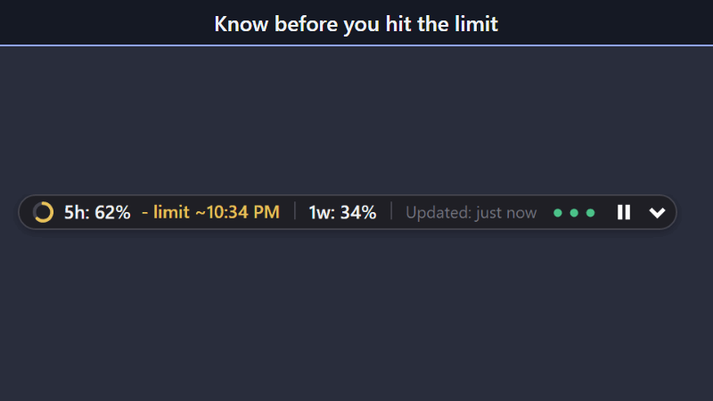
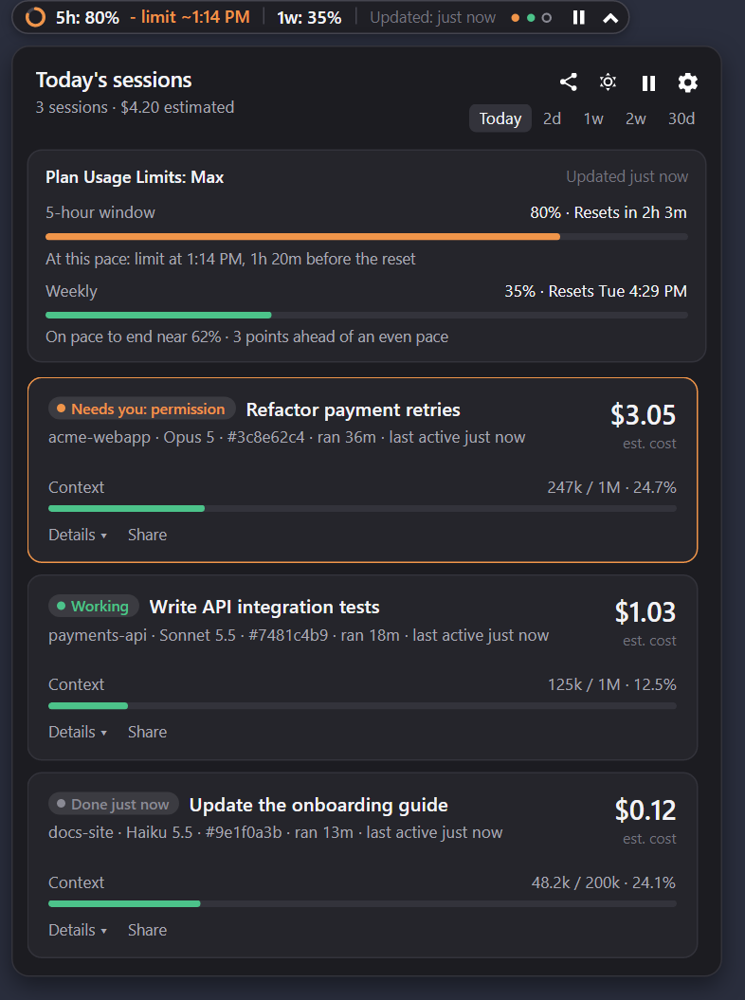
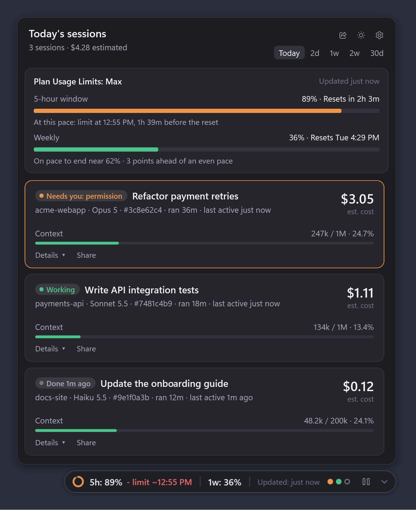
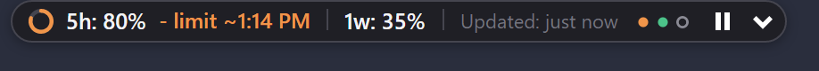
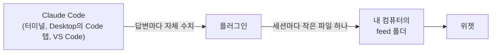
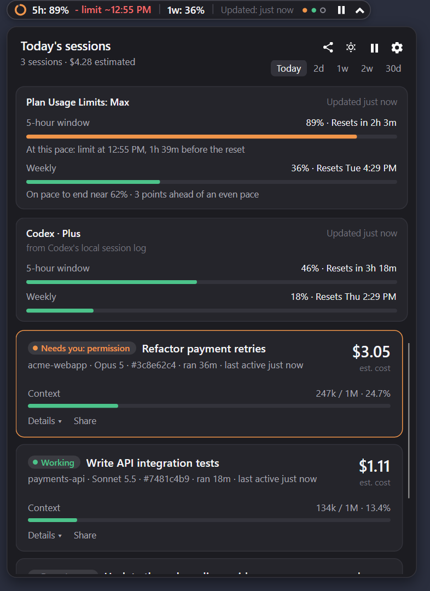
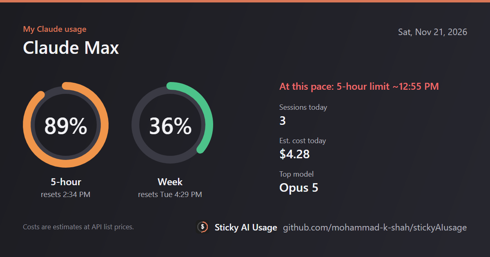

<div align="center">


# Sticky AI Usage

**한도에 닿기 전에 미리 알기.**<br/>
Claude Code 사용 한도, 지금 속도라면 한도에 닿는 시각, 그리고 어떤 세션이 당신을 기다리는지를 Windows 작업 표시줄이나 Mac 메뉴 막대에 보여 줍니다. 숫자는 Claude Code 자체에서 직접 받습니다.

[English](README.md) · [简体中文](README.zh-CN.md) · [日本語](README.ja.md) · **한국어**

<sub>2026-11-23 기준 영어 README의 번역입니다. 내용이 다르면 [영어 README](README.md)가 기준입니다. 원어민의 수정을 환영합니다.</sub>

⭐ **한도 때문에 작업이 멈추는 것을 막아 주었다면 Star를 눌러 주세요.**

<sub>독립 오픈 소스 프로젝트이며 Anthropic과 제휴하거나 승인을 받지 않았습니다.</sub>

<br/>



</div>

**한 줄로 설치**(자세한 내용과 다른 방법은 영어 README의 [Install](README.md#-install)):

```text
Windows   irm https://raw.githubusercontent.com/mohammad-k-shah/stickyAIusage/main/scripts/install.ps1 | iex
macOS     curl -fsSL https://raw.githubusercontent.com/mohammad-k-shah/stickyAIusage/main/scripts/install.sh | sh
Plugin    /plugin install sticky-usage --marketplace mohammad-k-shah/stickyAIusage      (Claude Code 안에서)
```

처음 실행하면 위젯이 플러그인 연결을 도와줍니다. Claude Code 명령줄이 있으면 클릭 한 번, 없으면 붙여 넣을 한 줄을 복사하면 됩니다.

<p align="center"></p>

---

## ⏱️ 한도에 닿기 전에 미리 알기

위젯은 5시간 창과 주간 창(또는 월 지출 한도)을 항상 보여 줍니다. 작업하는 동안 사용량이 차는 속도를 지켜보다가, 지금 속도라면 5시간 한도가 재설정보다 먼저 온다고 판단되면 카운트다운을 도달 예상 시각(예: "limit ~1:36 PM")으로 바꾸고, 1시간 이내면 주황색, 30분 이내면 빨간색으로 표시합니다. 창이 주황색이나 빨간색이 될 때, 한도까지 30분 남았을 때, 한도에 닿았을 때, 창이 재설정될 때("You're back") 각각 한 번씩 알림을 보냅니다. 같은 알림은 반복하지 않으며, 방해 금지 시간과 1시간 음소거도 있습니다.

<p align="center"></p>

## 🚦 어떤 에이전트가 기다리는지 알기

실행 중인 Claude Code 세션마다 위젯에 점이 하나씩 붙습니다. 당신을 기다릴 때(권한, 질문, MCP 서버 입력)는 **호박색**, 작업 중에는 **초록색**, 끝나면 **회색**입니다. 20초 동안 기다린 세션이 있으면 어느 세션인지 한 번 알려 줍니다. 패널에서는 기다리는 세션이 맨 위에 옵니다.

<p align="center"></p>

## 🤝 에이전트도 알게 하기

같은 플러그인은 위젯이 있든 없든 Claude Code 안에서도 동작합니다: `/pace`, 한도에 가까울 때 프롬프트 위에 나오는 한 줄, Claude가 길거나 병렬인 작업 전에 호출하는 도구, 그리고 한도에 가까울 때 하위 에이전트를 시작하기 전에 한 번 묻는 예산 가드(그대로 실행, Haiku 사용, 건너뛰기)입니다.

```text
/pace
5-hour: 43% used · resets 4:30 PM · at this pace: limit ~4:12 PM
Week:   14% used · resets Fri 3:30 PM · under an even pace
Session: context 24% · cost $3.05

● 5h 89% · limit ~3:27 PM · week 36%          ← 한도의 절반을 쓰면 프롬프트 위에 표시
```

## 🔑 숫자는 어디서 오나요



| 보이는 것 | 출처 | 신뢰도 | 컴퓨터 밖으로 나가나요? |
|---|---|---|---|
| 5시간·주간·지출 한도와 재설정 시각 | 답변마다 Claude Code가 플러그인에 넘기는 자체 수치 | 공식(Claude Code의 문서화된 인터페이스) | 아니요 |
| 어떤 세션이 작업 중이거나 기다리는지 | 같은 플러그인을 거친 Claude Code 이벤트 | 공식 | 아니요 |
| 세션 비용, 토큰, 컨텍스트, 모델 | 내 컴퓨터의 Claude Code 세션 파일(또는 플러그인을 거친 Claude Code 자체 수치) | 추정(로컬 파일) | 아니요 |
| 지금 속도로 한도에 닿는 시각 | 위 수치로 내 컴퓨터에서 계산 | 추정이라고 표시 | 아니요 |
| Codex 한도(Codex를 쓰는 경우) | 내 컴퓨터에 있는 Codex 자체 세션 로그 | 추정 | 아니요 |

**기본 설정에서는 Claude 로그인 정보를 읽지 않으며 네트워크 요청도 하지 않습니다.** 설정 → **Usage source**에는 **Automatic**과 **Legacy**도 있어, Claude Code가 저장한 로그인 정보를 읽고 Anthropic의 사용량 서비스에 묻습니다(달러 단위 월 지출 한도와 크레딧에 유용하며, 플러그인으로는 받을 수 없습니다). 이 서비스는 다른 앱용으로 문서화되어 있지 않습니다. 이 모드들은 로그인 정보를 읽기만 하며, 갱신하거나 Claude의 어떤 것도 바꾸지 않습니다. 이전 버전에서 업데이트하면 기존 숫자가 계속 나오도록 Automatic이 유지됩니다. 모두 끄려면 **Plugin**을 고르세요. 읽고 쓰는 모든 파일과 보낼 수 있는 모든 요청, 각각을 끄는 방법은 [Data sources](docs/DATA-SOURCES.md)(영어)에 있습니다.

## 📚 할 수 있는 일

|  | |
|---|---|
| 📊 **실제 한도** | 월 한도 대비 지출, 또는 Pro/Max 요금제의 5시간·주간 창을 정확한 초기화 시각과 함께 |
| ⏱️ **초기화까지 버틸 수 있을까?** | 지금 속도라면 5시간 한도에 언제 닿는지("limit ~4:12 PM", 가까워지면 빨간색), 이번 주나 이번 달이 어디쯤에서 끝날지, 균등 속도보다 빠른지 알려 줍니다. 추정치이며 그렇게 표시합니다 |
| 🔔 **막히기 전에 미리 알림** | 창이 주황이나 빨강으로 바뀔 때, 지금 속도로 30분 안에 한도에 닿을 때, 한도에 닿았을 때, 그리고 초기화될 때("You're back") 조용한 알림을 한 번씩. 같은 알림은 두 번 오지 않으며, 방해 금지 시간과 1시간 음소거가 있습니다 |
| 🚦 **어떤 세션이 기다리는지** | Claude Code 세션마다 위젯에 점이 하나씩: 권한이나 답을 기다리면 호박색, 작업 중이면 초록, 끝나면 회색. 세션이 20초 동안 기다리면 알림 한 번. 마우스를 올리면 어떤 세션이 무엇을 기다리는지 보입니다 |
| 🔌 **Claude Code에서 바로** | 함께 제공되는 플러그인을 쓰면 Claude Code가 턴마다 한도 수치를 직접 넘겨줍니다. 로그인 정보를 읽지 않고, 네트워크도 쓰지 않습니다 |
| 🤝 **Codex도** | OpenAI Codex도 쓰나요? Codex의 5시간·주간 한도가 Claude 아래에 별도 카드로 표시됩니다. 수치는 컴퓨터에 있는 Codex 자체의 세션 로그에서 읽으며, 로그인 정보도 네트워크도 쓰지 않습니다. Codex가 한도에 더 가까우면 위젯에 "Codex 91%"라고 표시됩니다 |
| 💬 **Claude Code 안에서도** | 같은 플러그인이 `/pace`, 한도에 가까울 때 프롬프트 위에 뜨는 조용한 한 줄, 그리고 Claude가 길거나 병렬인 작업 전에 호출하는 도구를 추가합니다. 위젯 없이도 동작하며, 위젯과 함께 쓰면 둘 다 같은 도달 시각을 보여 줍니다 |
| 🛡️ **서브에이전트 안전벨트** | 한도에 가까울 때 Claude가 서브에이전트를 시작하기 전에 한 번만 묻습니다: 그대로 실행, Haiku로 실행, 또는 건너뛰기. 팬아웃마다 한 번만 묻고, `claude -p`에서는 묻지 않습니다 |
| 👋 **1분이면 시작** | 처음 실행하면 안내해 줍니다: 앱이 읽는 것, Claude Code 플러그인 연결(클릭 한 번으로 설치하거나, 명령을 복사해 Claude Code에 붙여넣기), 로그인 시 자동 실행. **설정 → Health**에서 언제든 모든 것을 다시 점검하고, 문제가 있으면 해결 방법을 알려 주며, 버그 신고용 보고서를 복사해 줍니다 |
| 🧠 **요금제 자동 인식** | 계정이 어떻게 청구되는지 파악해 알맞은 레이아웃을 고릅니다. 설정할 것이 없습니다 |
| 🪟 **방해하지 않음** | Windows 작업 표시줄 안 트레이 옆(모니터 선택 가능)이나 Mac 메뉴 막대에. 바탕 화면으로 끌어내면 전체 크기로, 놓은 자리에 그대로 있습니다. 발표 중이거나 전체 화면으로 볼 때는 숨습니다. 클릭 한 번으로 일시 정지. 유휴 시 CPU 0%(디스크에 대화 기록이 5,000개 있어도) |
| 🗂️ **오늘의 작업** | 클릭 한 번으로 오늘의 모든 Claude Code 세션을 비용, 토큰, 컨텍스트, git 상태와 함께 보여 줍니다 |
| 💵 **현재 가격 기준 비용** | 세션 비용은 Anthropic의 현재 가격표를 따릅니다. 가격표는 누구나 고칠 수 있는 데이터 파일 하나입니다. 플러그인을 쓰면 Claude Code가 직접 보고한 비용을 보여 줍니다 |
| 📣 **공유하기** | 클릭 한 번으로 오늘의 사용량이나 세션 하나("this refactor cost $3.05")를 디자인된 이미지로 만들어 클립보드에 넣어 줍니다. 게시물에 바로 붙여넣으세요. 12월과 1월에는 Claude Code와 함께한 한 해도. 직접 켜지 않으면 프로젝트 이름은 나오지 않습니다 |
| 🧩 **나만의 레이아웃** | 수십 개의 필드를 끌어다 놓기, 여덟 가지 색, 실시간 미리 보기 |
| 🌗 **라이트와 다크** | 컴퓨터 설정을 따르거나 하나로 고정 |
| 🔒 **개인 정보 보호** | 모든 것이 내 컴퓨터에 머뭅니다. 텔레메트리 없음, 계정 없음, 모델 호출 없음 |

<p align="center">&nbsp;&nbsp;</p>

## ❓ 자주 묻는 질문

**상태 줄(status line)만으로는 안 되나요?** Claude Code의 상태 줄은 보고 있는 터미널 안에만 있습니다. 위젯은 모든 앱 위에서 보이고, Claude Desktop의 Code 탭에서도 동작하며, 여러 세션을 한눈에 보여 주고, 한도 도달을 예측해 알려 줍니다. 상태 줄을 빼앗지도 않습니다. 플러그인은 프롬프트 위에 자기 줄을 따로 띄우고 `statusLine` 설정은 건드리지 않습니다.

**로그인 정보를 읽나요?** 기본 설정에서는 읽지 않습니다. 새로 설치하면 Claude Code가 플러그인에 넘기는 수치만 사용합니다. 설정 → Usage source에서 **Automatic**이나 **Legacy**를 고를 때만 Claude Code가 저장한 로그인 정보를 읽습니다(선택지 옆에 그렇게 표시됩니다).

**사용량을 소모하나요?** 아니요. 모델을 호출하지 않으며, 사용량을 읽는 것은 한도에 영향을 주지 않습니다. 플러그인은 네트워크 요청을 전혀 하지 않습니다.

**Claude Desktop, VS Code, WSL에서 되나요?** 플러그인은 Claude Code가 플러그인을 실행하는 모든 곳에서 동작합니다: 터미널, Claude Desktop의 Code 탭, VS Code 확장. Claude Desktop의 WSL 세션에서는 플러그인이 로드되지 않으며, WSL 안의 Claude Code는 파일을 Linux 쪽에 저장하므로 Windows 위젯은 그곳을 보지 않습니다.

**Enterprise 월 한도는요?** 달러와 한도 대비 비율로 표시합니다. 플러그인은 게이트웨이의 지출 한도를 비율로만 넘기므로, 달러 단위 월 한도(와 크레딧)가 필요하면 설정 → Usage source에서 **Legacy**를 고르세요.

**Windows 다운로드가 왜 큰가요?** 표준 다운로드는 .NET 런타임을 포함하고 있어(압축 시 약 66 MB) 어떤 Windows 11에서도 실행됩니다. .NET 10 Desktop Runtime이 설치되어 있다면 `StickyAIusage-win-x64-small.zip`이 같은 앱이며 1 MB 미만입니다.

**Anthropic과 관련이 있나요?** 아니요. Claude Code와 함께 쓰도록 만든 독립 오픈 소스 프로젝트입니다.

---

그 밖의 내용(설치 세부 사항, 플러그인, 설정, 개인정보, 문제 해결, 향후 계획, 기여, 라이선스)은 [영어 README](README.md)를 보세요. 향후 계획은 [docs/ROADMAP.md](docs/ROADMAP.md), 기여 방법은 [docs/CONTRIBUTING.md](docs/CONTRIBUTING.md)에 있습니다(모두 영어).
