<div align="center">


# Sticky AI Usage

**Know before you hit the limit.**<br/>
Your Claude Code limits in the Windows taskbar or the Mac menu bar, the time you'll hit them at this pace, and which
session is waiting for you, straight from Claude Code itself.

**English** · [简体中文](README.zh-CN.md) · [日本語](README.ja.md) · [한국어](README.ko.md)

[](https://github.com/mohammad-k-shah/stickyAIusage/stargazers)
[](LICENSE)
[](#-install)

⭐ **Star it if this saved you a blocked session.**

<sub>An independent open-source project — not affiliated with or endorsed by Anthropic.</sub>

<br/>

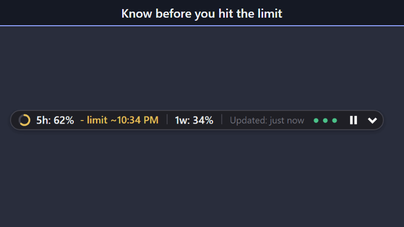<br/>
<sub>Drawn by the macOS app in demo mode (<code>--demo</code>): made-up projects, real screens. The Windows pill is the same, in the taskbar.</sub>

</div>

**New in 2.0:** your limits straight from Claude Code, the time you'll hit them at this pace, which session needs
you, Codex beside Claude, share cards and a year card, and a one-click start. [See what's new](docs/CHANGELOG.md#v200--the-highlights).

**Install in one line** (details and other ways: [Install](#-install)):

```text
Windows   irm https://raw.githubusercontent.com/mohammad-k-shah/stickyAIusage/main/scripts/install.ps1 | iex
macOS     curl -fsSL https://raw.githubusercontent.com/mohammad-k-shah/stickyAIusage/main/scripts/install.sh | sh
Plugin    /plugin install sticky-usage --marketplace mohammad-k-shah/stickyAIusage      (inside Claude Code)
```

On its first start the widget offers to connect the plugin for you: one click when Claude Code's command line is on your computer, or a line to paste.

<p align="center">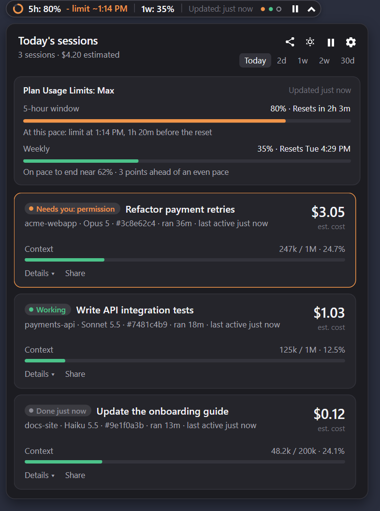</p>

---

## ⏱️ Know before you hit the limit

The pill shows your 5-hour and weekly windows (or your monthly spend cap) all the time. While you work it watches how
fast they fill: when the 5-hour limit would come before the reset, the countdown becomes the time you'd hit it, "limit
~1:36 PM", turning orange within the hour and red within 30 minutes. One notification comes when a window turns
orange or red, when the limit is 30 minutes away, when you reach it, and "You're back" when it resets. Never the same
one twice; quiet hours and a one-hour mute. [More](#%EF%B8%8F-will-you-make-it-to-the-reset)

<p align="center">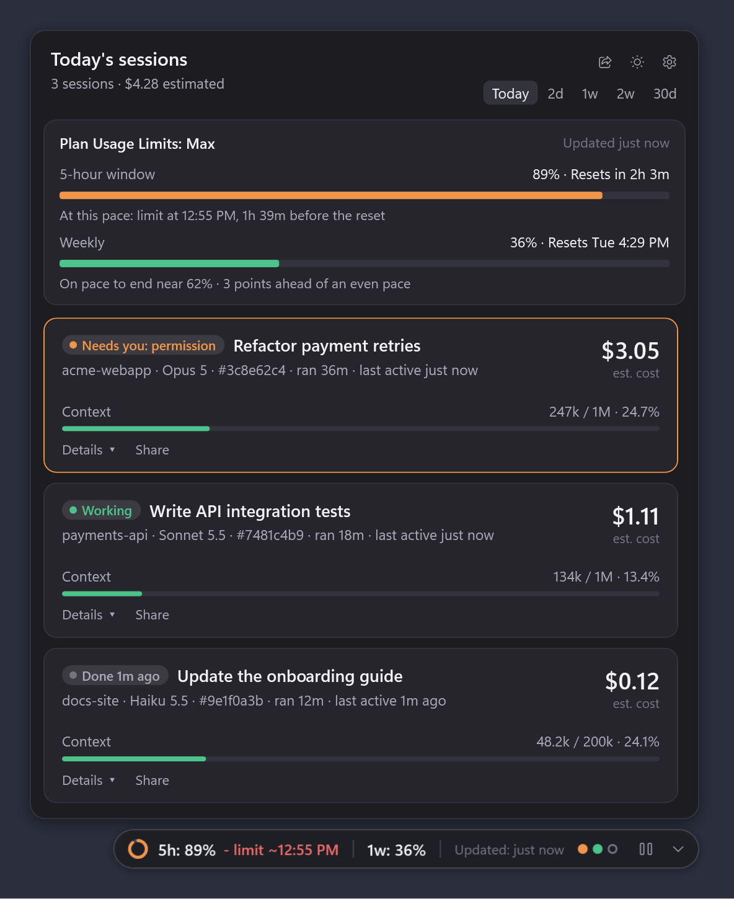</p>

## 🚦 Know which agent needs you

Each running Claude Code session gets a dot on the pill: **amber** when it waits for you (a permission, a question,
an MCP server's input), **green** while it works, **grey** when it's done. If one has waited 20 seconds, one
notification says which. The panel lists the waiting ones first. [More](#-which-session-needs-you)

<p align="center">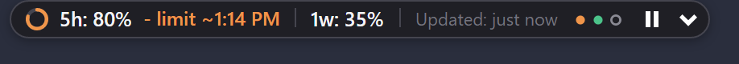</p>

## 🤝 Let the agent know too

The same plugin works inside Claude Code, with or without the widget: `/pace`, one line above the prompt near a limit,
a tool Claude calls before long or parallel work, and a budget guard that asks once before subagents start near a
limit (run anyway, use Haiku, or skip). [More](#-numbers-straight-from-claude-code-plugin)

```text
/pace
5-hour: 43% used · resets 4:30 PM · at this pace: limit ~4:12 PM
Week:   14% used · resets Fri 3:30 PM · under an even pace
Session: context 24% · cost $3.05

● 5h 89% · limit ~3:27 PM · week 36%          ← above the prompt, once a limit is half used
```

## 🔑 How it gets its numbers

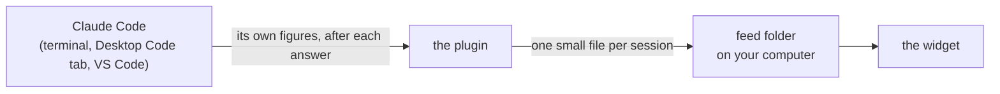

| What you see | Where it comes from | Trust | Leaves your computer? |
|---|---|---|---|
| 5-hour, weekly and spend limits, their resets | Claude Code's own figures, handed to the plugin after each answer | Official (a documented Claude Code interface) | No |
| Which session is working or waiting | Claude Code's events, through the same plugin | Official | No |
| Session cost, tokens, context, model | Claude Code's session files on your computer (or Claude Code's own figure via the plugin) | Derived (local files) | No |
| The limit time at this pace | Worked out on your computer from the readings above | Estimate, labelled | No |
| Codex's limits (if you use Codex) | Codex's own session log on your computer | Derived | No |

**Out of the box it never reads your Claude sign-in and makes no network request.** Settings → **Usage source** also
offers **Automatic** and **Legacy**, which read the sign-in Claude Code saved and ask Anthropic's usage service (useful
for monthly spend caps in dollars and credits, which the plugin doesn't carry); that service isn't documented for other
apps. They only read that sign-in: the app never renews it or changes anything of Claude's. An update from an
earlier version keeps Automatic so its numbers keep coming; choose **Plugin** to turn all of that off.
[Data sources](docs/DATA-SOURCES.md) lists every file it reads or writes and every request it can make, with how to
turn each off. The plugin itself never talks to the network, never runs a command and never calls a model:
[plugin/README.md](plugin/README.md) shows everything it can reach, as Claude Code itself reports it.

## 📚 Everything it does

|  | |
|---|---|
| 📊 **Your real limits** | Monthly spend against your cap, or your Pro/Max 5-hour and weekly windows with the exact reset times |
| ⏱️ **Will you make it to the reset?** | At your current pace it tells you when you'd hit the 5-hour limit ("limit ~4:12 PM", red when it's close), where your week or month ends up, and whether you're ahead of an even pace. An estimate, and it says so |
| 🔔 **A heads-up before you're blocked** | One quiet notification when a window turns orange or red, when at this pace you'd hit the limit within 30 minutes, when you hit it, and "you're back" when it resets. Never the same one twice; quiet hours and a one-hour mute |
| 🚦 **Which session needs you** | A dot per Claude Code session on the pill: amber when one waits for a permission or an answer, green while it works, grey when it's done. One notification if a session has waited 20 seconds. Hover for which one and for what |
| 🔌 **Straight from Claude Code** | With the companion plugin, Claude Code itself hands over your limits after every turn: no sign-in read, no network |
| 🤝 **Codex too** | Use OpenAI Codex as well? Its 5-hour and weekly limits get a card of their own under Claude's, read from Codex's own session log on your computer: no sign-in, no network. When Codex is the one close to its limit, the pill says so: "Codex 91%" |
| 💬 **Inside Claude Code too** | The same plugin adds `/pace`, a quiet band above the prompt near a limit, and a tool Claude calls before long or parallel work. Works without the widget; with it, both show the same limit time |
| 🛡️ **A seat-belt for subagents** | Near a limit, before Claude starts subagents, one question: run anyway, run them on Haiku, or skip them. Asked once per fan-out, never in `claude -p` |
| 👋 **Up in a minute** | The first start walks you through it: what the app reads, connecting the Claude Code plugin (one click runs the install, or copy the line for Claude Code), and start at login. **Settings → Health** checks it all again any time, says what to do about anything that isn't right, and copies a report for a bug report |
| 🧠 **Knows your plan** | It works out how your account is billed and picks the right layout. Nothing to set up |
| 🪟 **Out of the way** | Inside the Windows taskbar next to the tray (on the monitor you choose) or in the Mac menu bar, full size on the desktop, right where you left it; hidden while you present or watch full screen. Pause it with one click. Idle: 0% CPU, even with 5,000 transcripts on disk |
| 🗂️ **Today's work** | One click lists every Claude Code session from today with its cost, tokens, context and git state |
| 💵 **Costs at today's prices** | Session costs follow Anthropic's current price list, kept in one data file anyone can update; with the plugin, a session shows Claude Code's own figure |
| 📣 **Share it** | One click turns today's usage, or one session ("this refactor cost $3.05"), into a designed image on your clipboard, ready to paste into a post — and in December and January, your whole year with Claude Code. No project names unless you turn them on |
| 🧩 **Your layout** | 49 fields, drag and drop, eight colors, live preview |
| 🌗 **Light and dark** | Follows your computer, or pin either one |
| 🔒 **Private** | Everything stays on your machine. No telemetry, no accounts, no model calls |

## 🧭 Your plan, detected for you

Claude bills in two different ways, and the useful number is different for each. Sticky AI Usage works out which
one you're on and shows the right thing — and follows along if your plan changes.

### 💳 Monthly credit cap (Enterprise and credit plans)

<table>
  <tr>
    <td align="center" width="50%">
      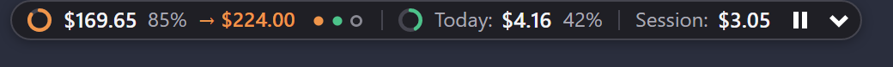<br/>
      <sub>Spend, share of the cap, and what this session has cost.</sub>
    </td>
    <td align="center" width="50%">
      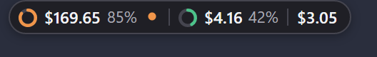<br/>
      <sub>Docked in the bar, the labels drop and the numbers stay.</sub>
    </td>
  </tr>
  <tr>
    <td align="center" colspan="2">
      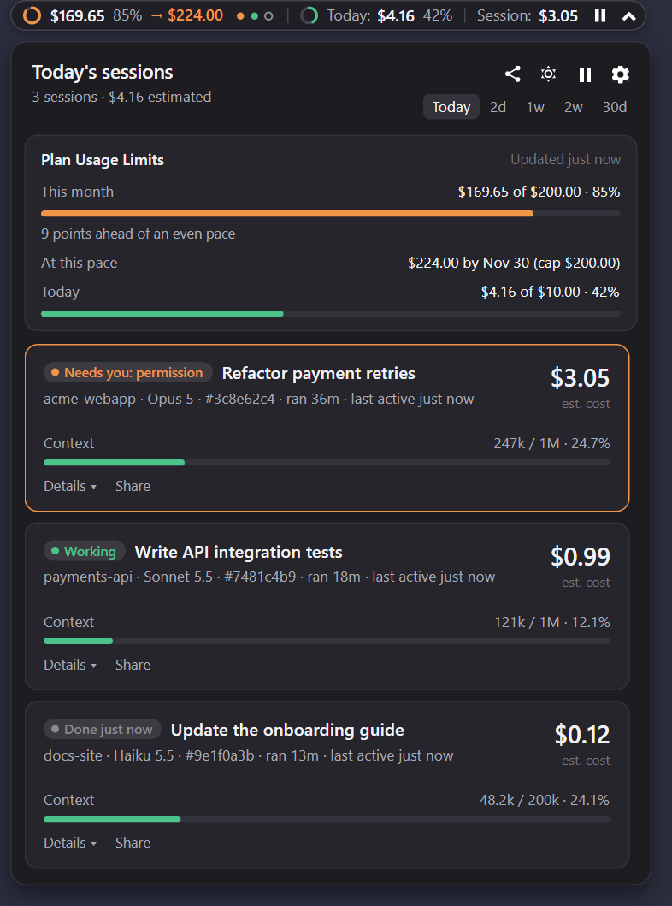<br/>
      <sub>Open it for the month as a bar — and today's sessions underneath. The ring turns yellow, orange then red as you approach the cap.</sub>
    </td>
  </tr>
</table>

### 🔁 Pro / Max plan limits

<table>
  <tr>
    <td align="center" width="50%">
      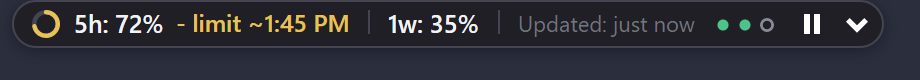<br/>
      <sub>Your 5-hour window, when it resets, your week, and how fresh the reading is.</sub>
    </td>
    <td align="center" width="50%">
      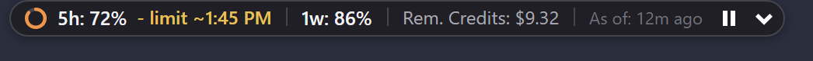<br/>
      <sub>Extra-usage credits when your account has them.</sub>
    </td>
  </tr>
  <tr>
    <td align="center" colspan="2">
      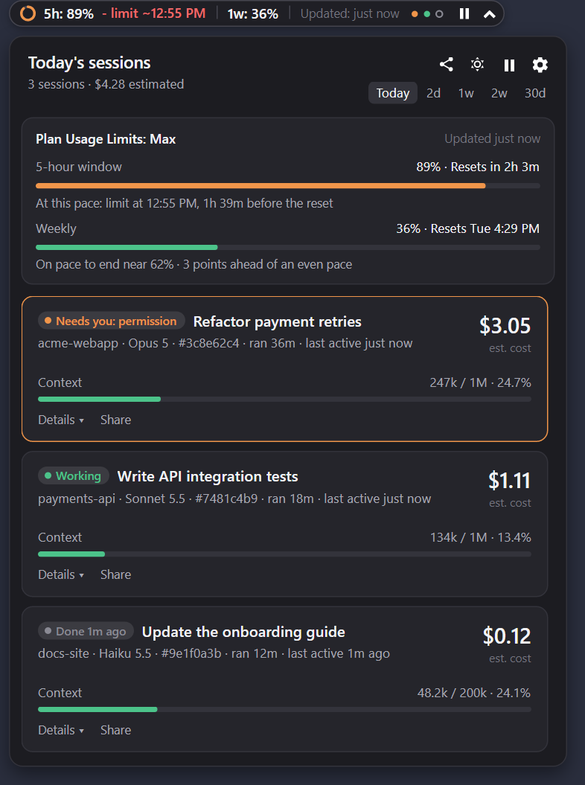<br/>
      <sub>Both windows as bars, with the weekly reset as a day and time.</sub>
    </td>
  </tr>
</table>

### ⏱️ Will you make it to the reset?

While you work, the widget keeps an eye on how fast each window fills. When the 5-hour limit would come before the
reset at that pace, the countdown in the pill turns into the time you'd hit it: yellow, orange within the hour, red
within 30 minutes. The panel says where each window is heading and how you compare with an even pace through the
week; on a monthly cap it projects the month's spend ("$212 by Nov 30 (cap $200)"). It needs about ten minutes of
activity before it says anything, never claims more than an estimate, and goes quiet when you stop. Settings →
**Pace forecast** turns it off.

<table>
  <tr>
    <td align="center">
      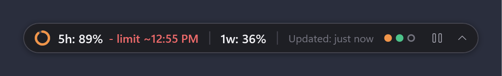<br/>
      <sub>The limit comes before the reset at this pace: the pill says when.</sub>
    </td>
  </tr>
  <tr>
    <td align="center">
      <br/>
      <sub>Each window gets a line on where it's heading.</sub>
    </td>
  </tr>
</table>

### 🔔 A heads-up, once

You don't have to be looking at the pill. The widget sends one notification (a toast on Windows, a banner on macOS)
when a window crosses your orange or red threshold, when at this pace you'd hit the limit within 30 minutes, when
you hit it, and "You're back" when a window that was busy resets. On a weekly window or a monthly cap it also warns,
at most once a day, when the pace would run it out early. Each one comes once, also across restarts. Clicking a
Windows notification opens the panel. Settings → **Usage alerts** turns them off, or each kind on its own, sets
quiet hours and sends a test; the tray or menu bar menu has **Mute alerts for an hour**. On macOS the banners come
from Apple's script runner, so macOS lists them under Script Editor: allow it once in System Settings →
Notifications.

### 🚦 Which session needs you?

With the [plugin](#-numbers-straight-from-claude-code-plugin), each running Claude Code session gets a dot
after the usage on the pill: **amber** (pulsing) when it waits for you (a permission, a question Claude asked, or an
MCP server's input), **green** while it works, a **grey ring** when it's done, **red** when it hit a rate limit. Up to
four dots, waiting ones first, then "+2"; in the taskbar or menu bar one dot (amber if any session needs you, green
if any is working). Hover the dots for one line per session ("acme-webapp — waiting for permission to use Bash
(2m)"). In the panel each card says the same ("Needs you: permission", "Working", "Done 3m ago"), the ones that need
you come first, and a card shows its title, status, cost, model and context bar, with the rest one click away
(**Details**).

If a session has waited 20 seconds, one notification says so: "Claude needs you — acme-webapp: waiting for
permission to use Bash". Once per wait. Optionally (off unless you turn it on) one when a task of a minute or more
finishes. Settings → **Session lights** turns the dots off; Settings → **Usage alerts** has both notifications.
A session that stopped without saying so (closed terminal, crash) reads "no signal" after four minutes and leaves
the pill after ten. The plugin records only the kind of wait and, for a permission, the tool's name: never your
prompt, a command or a file name. Without the plugin there are no dots, and the panel says how to get them.

### 📣 Show it off

The **Share** button at the top of the panel makes an image of today: your plan's 5-hour and weekly rings (or your
monthly spend against the cap), the pace line, today's sessions and their estimated cost, and the model you used
most. Each session card has its own **Share** for "this session cost $3.05": its cost, how long it ran, the model,
tokens, cache hits and context. Pick **Copy image** and paste it into a post, **Save image…** (Pictures, named
`usage-20261118-1430.png`), or **Post on X / LinkedIn / Bluesky**, which copies the image and opens that site's
share page with one line of text ("My Claude usage today — made with Sticky AI Usage" and the link); you paste the
image there. The card follows your light or dark theme, comes wide (1200×630, the shape link previews use) or
portrait (1080×1350) as Settings → **Share card** says, and labels estimates as estimates.

**Nothing private by default:** a shared session is "in a project"; its folder, project, session name, branch and
repository never appear unless you turn on **Project names** (then the project and session name do; branches,
repositories and your account never). If the clipboard refuses the image, it is saved to Pictures and the panel says
where.

**Your year with Claude Code.** From 1 December to 31 January the panel's **Share** menu also has **My 2026 with
Claude Code** (in January, the year just ended): the year's tokens, what they would have cost at API list prices
(labelled an estimate — never what you paid), how many sessions and active days, your favorite model and your busiest
day. It reads the year's transcripts once in the background (the panel counts them while it does; about two seconds
for 400 MB here) and keeps a small daily summary in its data folder, so later it reads only what changed since. Its
numbers are counted exactly like the session cards'. It never names a project, even with **Project names** on.

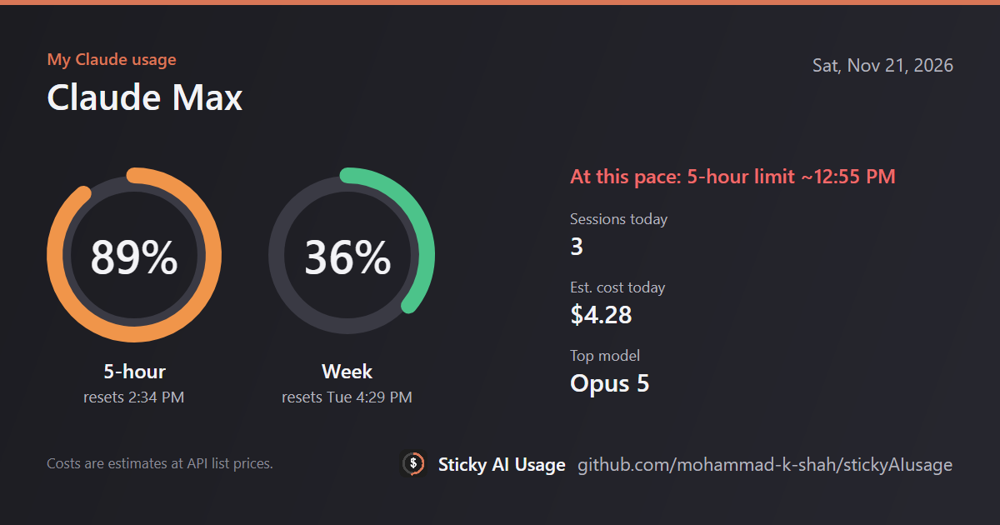 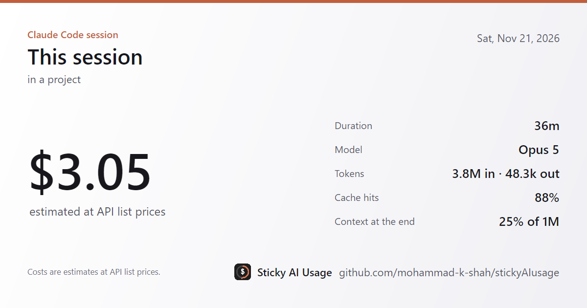
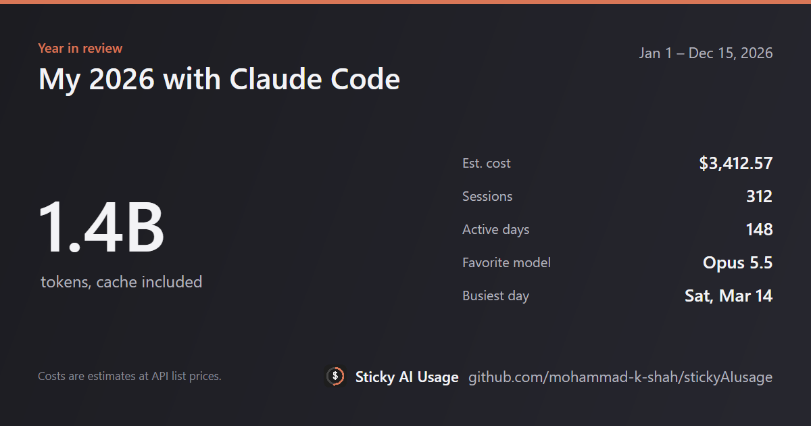

## 🪟 Docked or free

On a Mac it starts in the menu bar in a compact form. On Windows it sits **inside the taskbar**, just left of the tray
icons, like a system indicator, sized to the taskbar; when the taskbar has no room left beside your app buttons, it
waits just above the tray instead and moves back in when room opens up. Pick the monitor whose taskbar it uses, or
"Above the taskbar", in Settings → **Widget position** (or the tray menu's **Move widget to**). Drag it onto the desktop
and the full readout comes back; it stays where you left it, also after a restart, and if that spot is on a monitor
that's no longer there it docks again. It steps aside while a full-screen app, a film or a presentation is on its
monitor, so a screen share never shows your numbers.

<div align="center">
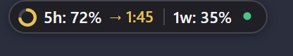&nbsp;&nbsp;
</div>

## 🌗 Light and dark

The whole app follows your computer's appearance and switches with it. The sun/moon button in the panel pins
either one whenever you want, and Settings → **Theme** goes back to following the computer. Your choice stays
after a restart.

<table>
  <tr>
    <td align="center" width="50%">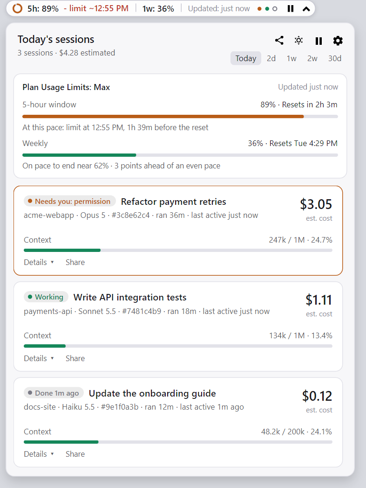<br/><sub>Light</sub></td>
    <td align="center" width="50%"><br/><sub>Dark</sub></td>
  </tr>
</table>

## 🧩 Make the card yours

**Settings → Session cards → Customize** opens full screen: 49 fields on the left, your card on the right, and a
live preview of the real thing underneath.

<div align="center">
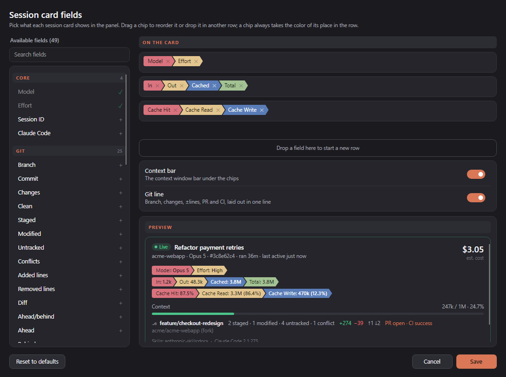
</div>

- **Click a field** and it lands beside the others of its kind — model with model, git with git.
- **Drag any chip** into any row, or onto the strip at the bottom to start a new one.
- **Colors follow position,** so a chip takes its new slot's color the moment you drop it.
- **Eight to a row.** Rows with room light up while you drag, and nothing is ever silently dropped.

## 📸 More screenshots

### macOS

<table>
  <tr>
    <td align="center" width="50%">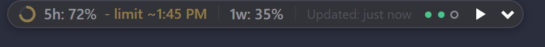<br/><sub><b>Paused.</b> Dimmed, with a play button.</sub></td>
    <td align="center" width="50%">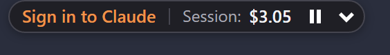<br/><sub><b>Signed out.</b> It says so, and picks up your new sign-in by itself.</sub></td>
  </tr>
  <tr>
    <td align="center" width="50%">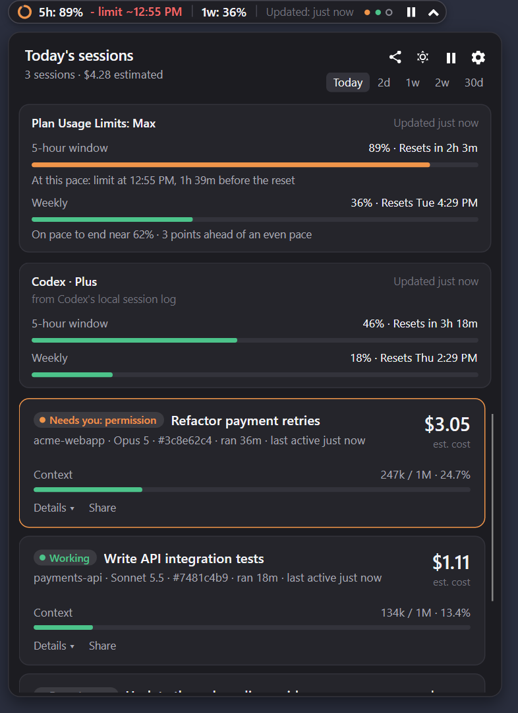<br/><sub><b>Codex beside Claude.</b> Its own card, and "Codex 91%" on the pill when it is the one close to its limit.</sub></td>
    <td align="center" width="50%">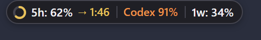<br/><sub><b>In the menu bar.</b></sub></td>
  </tr>
  <tr>
    <td align="center" width="50%">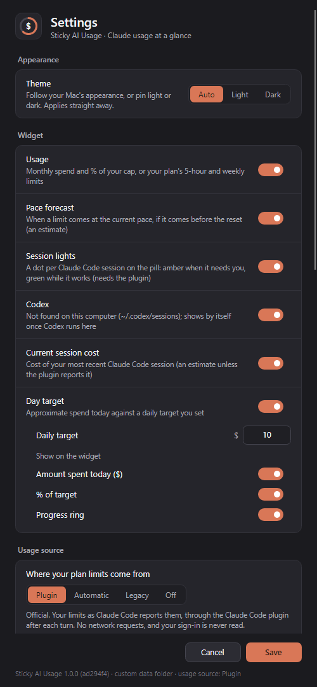<br/><sub><b>Settings.</b></sub></td>
    <td align="center" width="50%">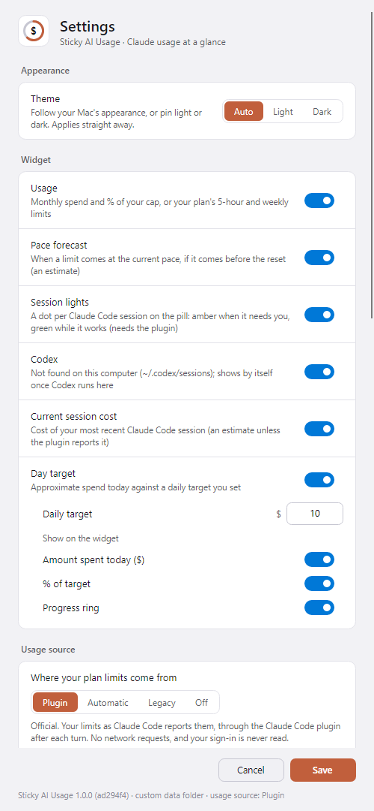<br/><sub><b>The same, light.</b></sub></td>
  </tr>
</table>

### Windows 11

<table>
  <tr>
    <td align="center" width="50%">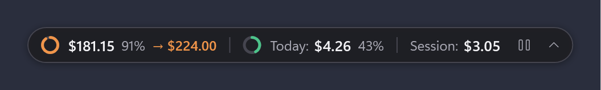<br/><sub><b>Approaching the cap.</b> Orange at 80%.</sub></td>
    <td align="center" width="50%">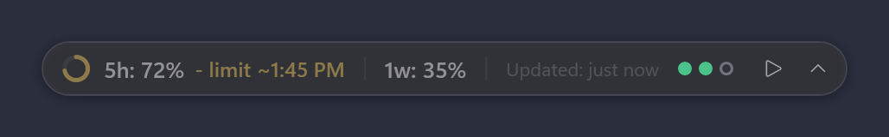<br/><sub><b>Paused.</b></sub></td>
  </tr>
  <tr>
    <td align="center" colspan="2">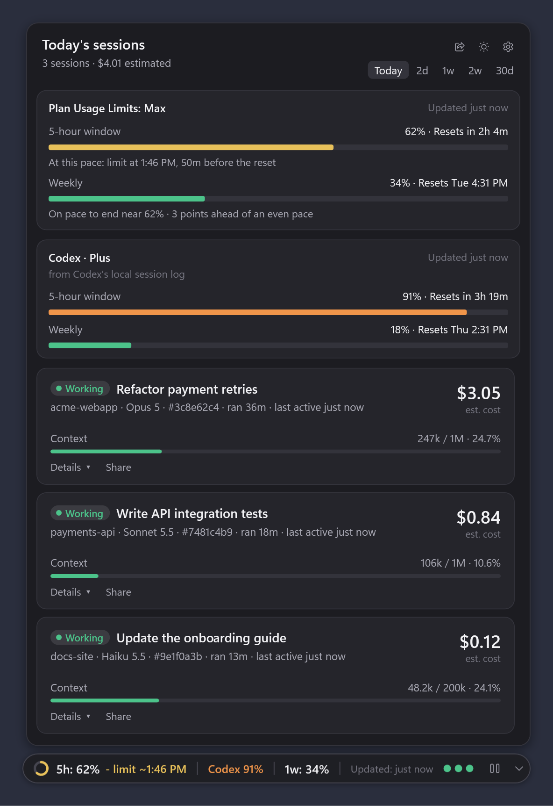<br/><sub><b>Codex beside Claude.</b> Its own card, and "Codex 91%" on the pill while it is the closer one to a limit.</sub></td>
  </tr>
</table>

## ❓ FAQ

**Why not just the status line?** Claude Code's status line lives in the terminal you're looking at. The widget stays
visible over every app, works with the Code tab of Claude Desktop, shows several sessions at a glance, forecasts the
limit and notifies you. It doesn't take your status line away either: the plugin adds its own line above the prompt
and never touches your `statusLine` setting.

**Does it read my sign-in?** Not out of the box: a new install reads only what Claude Code hands its plugin. Only if
you choose **Automatic** or **Legacy** in Settings → Usage source does it read the sign-in Claude Code saved (and those
modes say so next to them).

**Does it use my quota?** No. It never calls a model; reading your usage costs nothing against your limits. The
plugin makes no network requests at all.

**Does it work with Claude Desktop, VS Code and WSL?** The plugin runs wherever Claude Code runs plugins: the terminal,
the Code tab of Claude Desktop and the VS Code extension. Plugins don't load in Claude Desktop's WSL sessions, and a
Claude Code inside WSL keeps its files in Linux, where the Windows widget doesn't look.

**Enterprise monthly caps?** Shown as dollars and a percentage of the cap. The plugin carries a gateway's spend limit
as a percentage only; for a monthly cap in dollars (and credits), choose **Legacy** in Settings → Usage source.

**Why is the Windows download large?** The standard download brings its own .NET runtime (about 66 MB zipped), so it
runs on any Windows 11. With the .NET 10 Desktop Runtime installed, `StickyAIusage-win-x64-small.zip` is the same app
under 1 MB.

**Can I try it without Claude Code?** Yes: start it with `--demo` (`StickyAIusage.exe --demo`; on a Mac
`open "/Applications/Sticky AI Usage.app" --args --demo`). It plays two minutes of made-up usage, sessions and alerts in
a temporary profile and reads nothing of yours.

**Is it affiliated with Anthropic?** No. It's an independent open-source project, built to work with Claude Code.

## 🚀 Install

**You'll need:** Windows 11 or macOS 15+ (Apple Silicon or Intel), and **Claude Code** (the terminal, the Code tab
of Claude Desktop or VS Code) with the [companion plugin](#-numbers-straight-from-claude-code-plugin) for your
limits. Nothing else — the downloads run as they are.

**[How it gets its numbers](#-how-it-gets-its-numbers)** — out of the box it never touches your Claude sign-in.

**One line each:**

```text
Windows   irm https://raw.githubusercontent.com/mohammad-k-shah/stickyAIusage/main/scripts/install.ps1 | iex
macOS     curl -fsSL https://raw.githubusercontent.com/mohammad-k-shah/stickyAIusage/main/scripts/install.sh | sh
Plugin    /plugin install sticky-usage --marketplace mohammad-k-shah/stickyAIusage      (inside Claude Code)
```

- **Windows** (paste it into PowerShell, not Command Prompt): installs for you only, no admin rights, into
  `%LOCALAPPDATA%\Programs\Sticky AI Usage` with a Start Menu shortcut, and starts it. A file a script downloads isn't
  marked as coming from the internet, so there is no *"Windows protected your PC"* prompt.
- **macOS** (paste it into Terminal): installs **Sticky AI Usage** into Applications (`~/Applications` if you can't
  write to `/Applications`) for your Mac's chip and opens it. It isn't notarized yet; if macOS still says it can't
  check the app, go to **System Settings → Privacy & Security** and click **Open Anyway**.
- Both scripts download the newest release from the Releases page, check it against the release's `checksums.txt`
  (SHA-256) and stop without installing anything if it doesn't match. They change nothing else on your computer, and
  never close a running copy: they ask you to exit it from its tray icon or menu bar first. Running one again updates
  the app. With **Check for updates** on, the app tells you when a newer version is out and shows this line to update.
  They are short — [read them first](scripts/) if you like.
- **Every release is smoke-tested, checksummed and attested.** Before a release is published, CI starts the very
  files you download with `--self-test` (a temporary profile, no window: the tray icon, every screen, the price list
  and the settings must load) and stops the release if one fails. `checksums.txt` lists every file's SHA-256, and
  each file carries a signed build provenance: `gh attestation verify <file> --repo mohammad-k-shah/stickyAIusage`
  shows the workflow run and commit it was built from.
- **Remove it:** Windows `& ([scriptblock]::Create((irm https://raw.githubusercontent.com/mohammad-k-shah/stickyAIusage/main/scripts/install.ps1))) -Uninstall`
  · macOS `curl -fsSL https://raw.githubusercontent.com/mohammad-k-shah/stickyAIusage/main/scripts/install.sh | sh -s -- --uninstall`.
  Your settings stay unless you add `-Purge` / `--purge`. Other options: `-Version v2.0.0` / `--version v2.0.0` for
  one release, `-Prerelease` / `--prerelease` for the newest beta.
- **Coming:** `winget install MohammadKShah.StickyAIUsage` and a Scoop bucket.

<details>
<summary>Manual download</summary>

1. Get the latest build from the **[Releases page](https://github.com/mohammad-k-shah/stickyAIusage/releases)**:
   - **macOS (Apple Silicon)**: [`StickyAIusage-mac-apple-silicon.zip`](https://github.com/mohammad-k-shah/stickyAIusage/releases/latest/download/StickyAIusage-mac-apple-silicon.zip)
   - **macOS (Intel)**: [`StickyAIusage-mac-intel.zip`](https://github.com/mohammad-k-shah/stickyAIusage/releases/latest/download/StickyAIusage-mac-intel.zip)
   - **Windows 11**: [`StickyAIusage-win-x64.zip`](https://github.com/mohammad-k-shah/stickyAIusage/releases/latest/download/StickyAIusage-win-x64.zip)
2. Unzip it.
   - **macOS**: drag **Sticky AI Usage** to your Applications folder and open it. It isn't notarized yet, so macOS
     blocks the first launch: go to **System Settings → Privacy & Security**, scroll down and click
     **Open Anyway**.
   - **Windows**: put the folder wherever you like and run `StickyAIusage.exe`. It isn't code-signed yet, so if
     Windows shows *"Windows protected your PC"*, click **More info → Run anyway**.
3. **macOS**: the widget appears in your menu bar, left of your status icons. **Windows**: in the taskbar, left of your tray icons (just above them when the taskbar has no room).
4. Click it for today's sessions; drag it anywhere you prefer; the gear opens Settings.
5. Turn on **Launch at login** / **Start with Windows** in Settings and forget about it.

Prefer an installer on Windows? `StickyAIusage-Setup-x64.exe` on the Releases page installs it for you only (no admin
rights) with a Start Menu shortcut and an entry in **Settings → Apps** to remove it. It isn't code-signed yet, so the
same *"Windows protected your PC"* step applies. It won't update or remove a copy that is running: exit it from the
tray first. Removing it asks whether to delete your settings too.

Already have the [.NET 10 Desktop Runtime](https://dotnet.microsoft.com/download/dotnet/10.0)? Each release also has
`StickyAIusage-win-x64-small.zip`: the same Windows app at well under 1 MB instead of about 66 MB. To check a
download by hand, compare `Get-FileHash <file>` (Windows) or `shasum -a 256 <file>` (macOS) with the release's
`checksums.txt`, or run `gh attestation verify <file> --repo mohammad-k-shah/stickyAIusage` (GitHub CLI). To see that
a copy starts on your computer without changing anything: `.\StickyAIusage.exe --self-test | Out-Host` (PowerShell)
or `"/Applications/Sticky AI Usage.app/Contents/MacOS/StickyAIusage" --self-test` (macOS) prints one PASS or FAIL line
per check; add a file name after `--self-test` to keep the report.
</details>

<details>
<summary>Prefer to build it yourself?</summary>

```bash
git clone https://github.com/mohammad-k-shah/stickyAIusage.git
cd stickyAIusage

# Both need the .NET 10 SDK: https://dotnet.microsoft.com/download/dotnet/10.0

# macOS
scripts/build-mac-app.sh            # add osx-x64 for Intel Macs
open "artifacts/mac/Sticky AI Usage.app"

# Windows
dotnet run --project src\StickyAIusage\StickyAIusage.csproj
```
</details>

> [!NOTE]
> Only one copy runs at a time — launching it again while it's running opens the one that's already there.
> (Developers can run a second, separate copy with `--profile <name>`; see [docs/CONTRIBUTING.md](docs/CONTRIBUTING.md).)

## 🔌 Numbers straight from Claude Code (plugin)

The companion **Claude Code plugin** hands Claude Code's own figures to the widget: your 5-hour and weekly limits
(or a gateway's spend limit), and each session's context and cost. Claude Code reads them from its own responses,
so the widget gets them **without touching your sign-in and without a network request**. It works wherever Claude
Code runs plugins: the terminal, the Code tab of Claude Desktop and the VS Code extension.

<p align="center">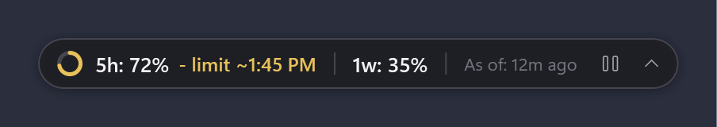</p>

The widget's first start (or **Connect…** in its panel, or Settings → **Health**) installs it for you with one click
when Claude Code's command line is on your computer: it shows the command, runs it, and turns green the moment Claude
Code sends its first numbers. Or install it yourself, in Claude Code (version 2.1.287 or later; tested with 2.1.318
and 2.1.325):

```text
/plugin install sticky-usage --marketplace mohammad-k-shah/stickyAIusage
```

or from a shell:

```bash
claude plugin install sticky-usage --marketplace mohammad-k-shah/stickyAIusage
```

In Claude Desktop's Code tab, where `/plugin` doesn't run: click **+** next to the prompt box, then **Plugins**,
**Add marketplace** with `mohammad-k-shah/stickyAIusage`, then **Add plugin**.

- **What it does for the widget:** after each turn (and when a session starts and ends) it writes one small JSON file
  per session to the widget's `feed` folder: `%LOCALAPPDATA%\StickyAIusage\feed` on Windows,
  `~/Library/Application Support/StickyAIusage/feed` on macOS. No network, no commands, no model calls.
  [plugin/README.md](plugin/README.md) lists every call it makes.
- **What it does inside Claude Code** (on any OS, with or without the widget):

  ```text
  /pace
  5-hour: 43% used · resets 4:30 PM · at this pace: limit ~4:12 PM
  Week:   14% used · resets Fri 3:30 PM · under an even pace
  Session: context 24% · cost $3.05
  ```

  Above the prompt, one line once a limit is half used or the pace says you'll hit it before the reset:
  `● 5h 89% · limit ~3:27 PM · week 36%`. Ask Claude "how much of my limit is left?" and it looks it up with the
  plugin's `usage_status` tool, and it checks before long or parallel work. From 80% of a window, one short note
  beside your prompt tells Claude to take smaller steps (at most once every ten prompts; your text is never
  changed). Each part has an off switch in `/config`; [plugin/README.md](plugin/README.md) has the options.
- **A budget guard for subagents:** at 90% of the 5-hour window (or when the pace says the limit is 15 minutes
  away, or at 97% of the week), Claude Code asks once before subagents start: **Run anyway**, **Use Haiku for
  subagents** or **Skip subagents** (Claude then goes on alone). The answer holds for ten minutes, so a fan-out of
  six asks once. `guard: downshift` picks the smaller model without asking and says so; `guard: off` turns it off.
  It never asks where no one could answer (`claude -p`, the Agent SDK) and never refuses on its own.
- **Session lights:** the same file says whether the session is working, waiting for you (and for what kind of
  answer: a permission, a question, an MCP server's input; for a permission the tool's name) or done. Claude Code
  tells the plugin through its own events; the plugin never records your prompt, a command or a path from them.
- **The limit time** comes from the widget's own forecast while the widget runs, so the pill and `/pace` agree;
  without it, the plugin works it out from the readings it keeps, after about ten minutes of activity.
- **When the numbers move:** whenever Claude Code gets a response. Once the last one is over three minutes old, the widget says
  `As of: 12m ago` instead of `Updated`; what you use in other Claude apps shows up with your next Claude Code turn.
- **Removing it:** `/plugin` → uninstall `sticky-usage`, then delete the `feed` folder and the plugin's kept readings
  (`plugins/store/sticky-usage*.json` in Claude Code's folder, `~/.claude`). That is all it leaves behind.

## ⚙️ Settings

| Setting | What it does |
|---|---|
| **Health** | What works and what doesn't, each with one button for the next step: Claude Code found and its version, the plugin connected (and when it last wrote), where your limits come from, legacy mode, today's sessions, notifications (**Send a test alert**), start at login, Codex, updates. **Copy report** puts versions, sources and every check on the clipboard for a bug report, with your home folder written as `~` |
| **Theme** | Follow your computer, or pin Light or Dark |
| **Usage** | Show your monthly spend, or your plan's 5-hour and weekly limits |
| **Pace forecast** | When a limit would come at your current pace, if that's before the reset (on unless you turn it off) |
| **Session lights** | A dot per Claude Code session on the pill: amber when it needs you, green while it works (needs the plugin; on unless you turn it off) |
| **Codex** | Show Codex's limits under Claude's, from Codex's own session log (on when Codex is on your computer; says "not found" otherwise) |
| **Current session cost** | Show what the session you're working in has cost |
| **Fields on each card** | Opens the customizer: which of the 49 fields a session card shows, and in what order |
| **Usage alerts** | The points where the ring turns yellow, orange and red (50 / 80 / 95 % out of the box; orange and red also notify you), and the notifications: on or off, which kinds (also when a Claude Code session needs you, and — off unless you turn it on — when a long task finishes), quiet hours, **Send a test alert** |
| **Share card** | The shape of a shared image (wide 1200×630 or portrait 1080×1350), and whether a shared session names its project and session (off unless you turn it on) |
| **Launch at login** | Start the widget when you sign in |
| **Widget position** | Windows: **In the taskbar** (the default) or **Above the taskbar**, and with several monitors which one's taskbar; **Reset** docks it again after a drag. macOS: put it back in the menu bar |
| **Hide in full screen** | Windows: step aside while a full-screen app, a film or a presentation is on the widget's monitor (on unless you turn it off) |
| **Check for updates** | Once a day, ask this project on GitHub whether a newer version is out (shown at the foot of the panel and in the menu, with the command that updates your copy; never installed for you), and fetch the latest model prices, so costs stay right when Anthropic changes a price or ships a model. Off unless you turn it on |
| **Usage source** | Where your plan limits come from: **Plugin** (official, no network, never reads your sign-in — what a new install uses), **Automatic** (the plugin, and Claude's usage service whenever the plugin has nothing current — what an update from an earlier version keeps), **Legacy** (the usage service only, as before the plugin: monthly spend caps in dollars and credits) or **Off**. Automatic and Legacy are unofficial and use your sign-in; Settings says so next to them. Applies on Save, no restart |

## 🔒 Privacy, and what it touches

The short version is below; [docs/DATA-SOURCES.md](docs/DATA-SOURCES.md) lists every file, program and web address,
per source, with its trust level and its off switch.

- **It never uses your budget.** Reading your usage costs nothing against it, and it never calls a model.
- **No telemetry, no account, no sign-up.** Nothing is sent to the author or any third party.
- **Where your limits come from:** Settings → **Usage source**. **Plugin** (new installs): the files the
  [plugin](#-numbers-straight-from-claude-code-plugin) writes to the widget's `feed` folder — no network, no
  sign-in. **Automatic** (what an update from an earlier version keeps): the plugin, and Claude's usage service
  whenever the plugin has nothing current. **Legacy**: the usage service only. **Off**: no limits at all.
- **What it reads on your computer:** the plugin's `feed` folder and Claude Code's session transcripts
  (`~/.claude/projects`). In Automatic and Legacy only, also the Claude sign-in that Claude Code already saved —
  `~/.claude/.credentials.json` on Windows, the *Claude Code-credentials* Keychain item on macOS. If you set
  `CLAUDE_CONFIG_DIR` to move Claude Code's folder, it reads that folder instead of `~/.claude`. It lists the
  transcripts once at start and then lets your system tell it what changed (a full look every ten minutes as a
  safety net) instead of re-reading the folder every few seconds. Session details never leave your machine.
- **If you use Codex:** the end of Codex's newest session logs (`~/.codex/sessions/<year>/<month>/<day>/rollout-*.jsonl`,
  or under `CODEX_HOME` if you set it) for the limits Codex wrote there after its last answer — nothing else in
  `~/.codex`, never Codex's sign-in (`auth.json`) or settings. These numbers are **derived**: Codex's file format is
  its own, not a documented interface, and the card says where they come from. Without Codex nothing is read and
  nothing is shown; Settings → **Codex** turns it off.
- **What it changes:** nothing of Claude Code's, in every mode. Automatic and Legacy only read the sign-in token;
  when it has expired, the numbers wait (the panel says so) until Claude Code runs again, which renews it by itself.
- **Who it talks to:** in Plugin mode and Off, nobody at Anthropic. In Automatic and Legacy,
  `api.anthropic.com` for your usage numbers, with your own Claude sign-in. If the GitHub CLI (`gh`) is installed and signed in, it also asks GitHub for the pull
  request and CI status of the repositories your sessions are in — only those whose `origin` is on GitHub, at most
  every five minutes each, while the panel is open. With **Check for updates** on (it is off unless
  you turn it on), once a day it asks `api.github.com` for this project's list of releases (to tell you about a
  newer version; it shows it and never installs anything) and downloads this project's price list
  (`data/models.json`) from `raw.githubusercontent.com`; nothing about you or your sessions is sent, only the app's
  name as the User-Agent. The answer is kept in `cache/update-check.json`.
- **Demo mode** (`--demo`) reads nothing of yours: no transcripts, no plugin files, no sign-in, no Codex logs, no
  git; it sends nothing. Its settings, alerts and log live in a temporary folder that is deleted when it exits.
- **Connect → Run it for me** (only when you click it, with the command shown first) runs Claude Code's own command
  line: `claude --version`, then `claude plugin install sticky-usage --marketplace mohammad-k-shah/stickyAIusage` (or the
  two-step form on an older Claude Code). Claude Code fetches the plugin from GitHub and records it in its own settings,
  as it does when you type the command; no model is called. The widget starts no other program for this, and never
  without a click.
- **Docking in the Windows taskbar** reads where the taskbar, its tray and its app buttons are (their positions only,
  through Windows' own window and UI Automation interfaces) when it starts and when the taskbar changes, and asks
  Windows whether a full-screen app or a presentation is running. Nothing is stored or sent.
- **Settings → Health** reads, besides the files above: the version line of your newest Claude Code transcript, the
  plugin's `feed/plugin.json`, and `plugins/installed_plugins.json` in Claude Code's folder (only to see whether the
  plugin is installed). It starts no process and sends nothing.
- **The install scripts** (only when you run one) ask `api.github.com` which release is the newest and download that
  release's zip and `checksums.txt` from `github.com`. Nothing about you is sent.
- **What it keeps on your computer:** a small journal of the usage readings it saw (`cache/journal.jsonl` in its
  data folder: the last eight days, 35 for a monthly cap) to work out your pace, and that pace in
  `feed/forecast.json`, where the plugin can read it. Neither leaves your machine. The plugin keeps its own short
  list of readings (the last 200 per window) in the store Claude Code gives each plugin, for `/pace` when the
  widget isn't running. Which notifications it already gave, so a restart doesn't repeat them, is in
  `cache/alerts.json`. For the session lights the plugin's file also says what each session is doing (working,
  waiting, done; the kind of wait and a tool's name), nothing more. Once you open **Share** in December or January,
  a daily summary of the year's Claude Code work for the year card: `cache/stats/<year>-<month>.json` (per day: tokens
  and estimated cost per model, the ids of the sessions that ran, responses per hour — no project names, no prompts).
- **Share cards** are made on your computer and go only where you put them: the clipboard, a file you save, or a
  post you paste them into. **Post on X / LinkedIn / Bluesky** opens that site's share page in your browser with a
  fixed line of text and the project's link; nothing about you or your usage is in the address. On macOS the image
  goes to the clipboard through a temporary file and Apple's `osascript`.
- **Notifications** stay on your computer: Windows shows them from the widget's tray icon; macOS shows them by
  running Apple's `osascript` with the notification's text (nothing else is run, and nothing is sent anywhere).
- **Git in your project folders:** it runs `git status`, `diff --numstat`, `rev-parse` and `remote -v` there,
  read-only, with a repository's own monitor hook, external diff and text filters switched off, and never waits on
  a password prompt.
- **Session costs are estimates** from the tokens in the transcripts at Anthropic's list prices
  ([`data/models.json`](data/models.json), which names its source and the day it was checked), unless the plugin
  hands over Claude Code's own figure for that session. A model the price list doesn't know yet is priced like its
  closest relative and shown with **≈**. Anthropic's bill is the authority.

## 🩺 Troubleshooting

| You see | What to do |
|---|---|
| Something isn't working | Settings → **Health**: every check, what's wrong and one button for the next step. **Copy report** for a bug report. |
| **Sign in to Claude** | Your Claude sign-in expired (Automatic and Legacy). Run `claude auth login` — the flyout copies the command for you, and on Windows **Sign in** opens a terminal with it — or `/login` inside Claude Code. The widget picks it up. |
| **Waiting for Claude Code** | No plugin numbers yet. Click **Connect…** in the panel to install the [plugin](#-numbers-straight-from-claude-code-plugin) (or copy the install command) and send Claude Code one message. For a monthly spend cap, choose **Legacy** in Settings → Usage source. |
| **Usage unavailable** | Click it: the panel says why and offers the next step (Settings → Health, or Settings when plan limits are turned off). In Automatic or Legacy, Claude's usage service couldn't be reached; it keeps retrying on its own. |
| `As of: 12m ago` | The plugin's numbers are from Claude Code's last turn. They move again with the next one. |
| `Updated: 12m ago` | Usage checks are being throttled or failing; the panel's first line says so. It resumes by itself. |
| A session is missing | Sessions where nothing happened (no cost) are hidden on purpose. |
| A cost starts with **≈** | The session used a model the price list doesn't know yet, so its cost is a rough estimate. Turn on **Check for updates**, or update to the next version. |
| No limit time in the pill | It shows only when the limit would come before the reset, after about ten minutes of activity, and only while usage is still rising. The panel's pace lines say where each window is heading. |
| No session dots | They need the [plugin](#-numbers-straight-from-claude-code-plugin) (version 2.2 or later) and Settings → **Session lights**. A session shows once Claude Code has started it with the plugin loaded; sessions in WSL or the cloud don't write to this computer. |
| No notifications | Settings → **Usage alerts** → **Send a test alert**. Nothing shows: on Windows check Do not disturb and Settings → System → Notifications; on macOS allow **Script Editor** in System Settings → Notifications. Also check quiet hours and **Mute alerts for an hour** in the tray or menu bar menu. |
| The widget is off-screen | Settings → **Widget position** → **Reset**. |
| The widget isn't in the taskbar | It goes in only when there's room left of the tray beside your app buttons; with many apps open (or a taskbar that hides itself) it waits just above the tray, and moves back in by itself. |
| The widget disappeared during a video or a call | **Hide in full screen** keeps it out of full-screen apps and presentations on its monitor; it comes back when they end. Turn it off in Settings. |
| The widget closed by itself | Start it again. `diagnostics.log` (tray or menu bar menu → **Open log folder**) has the error; an error inside the widget is logged and the widget keeps running. |
| Reporting a bug | The last line of Settings names the version, profile and usage source; please include it, and `diagnostics.log` if you can (your home folder is written as `~`). |

## 🗺️ What's next

- [x] macOS app
- [x] Pro / Max plans: 5-hour and weekly limits, credits
- [x] Light theme that follows your computer
- [x] Times in your computer's clock format (12- or 24-hour)
- [x] Session cards you can customize
- [x] Pace forecast: when you'd hit the limit at this pace
- [x] Notifications before you hit a limit, when you do, and when it resets
- [x] One-line install, checked against the release's checksums
- [x] Session lights: which Claude Code session needs you
- [x] A Windows installer (for you only, no admin rights)
- [x] Every release smoke-tested, checksummed and attested
- [x] Codex limits beside Claude's, from Codex's own session log
- [x] Share cards: today's usage or one session as an image, private by default
- [x] A year card for December and January: your year with Claude Code
- [x] A budget guard: one question before subagents start near a limit
- [x] A first-start walkthrough and Settings → Health
- [x] In the Windows taskbar itself, on the monitor you choose; out of the way in full screen
- [ ] winget and Scoop listings, signed and notarized downloads
- [ ] More AI tools beside Claude and Codex: GitHub Copilot, Gemini CLI, Cursor

What comes next, and later: [the roadmap](docs/ROADMAP.md).

## 🤝 Contributing

Issues and pull requests are very welcome — bug reports, ideas, a new field for the session card, or a plan
layout that doesn't look right on your account. Issues labelled `good first issue` say which files to touch and
when they're done; [how it fits together](docs/ARCHITECTURE.md) is one page, and adding another AI tool has
[its own guide](docs/PROVIDERS.md).

`main` holds released code only; all changes go through the **`develop`** branch:

1. **Fork** this repository.
2. Clone your fork and create a branch from the latest **`develop`**:
   `git checkout -b feature/my-change upstream/develop` (setup in [docs/CONTRIBUTING.md](docs/CONTRIBUTING.md)).
3. Make your change, **add unit tests for any code change**, and run them: `dotnet test tests/StickyAIusage.Tests`
4. Commit, then push your branch to your fork: `git push -u origin feature/my-change`
5. Open a **pull request** into **`develop`** (not `main`) and describe what changed and why.

Merged changes ship in the next release: bug fixes and small improvements as a minor or patch version, big new
features as a major version. Every contributor is credited on the release page. Details, code layout and build
steps: [docs/CONTRIBUTING.md](docs/CONTRIBUTING.md).

Questions and show-and-tell go to [Discussions](https://github.com/mohammad-k-shah/stickyAIusage/discussions); a bug,
an idea or another AI tool to support to [a new issue](https://github.com/mohammad-k-shah/stickyAIusage/issues/new/choose);
a security problem privately, as [SECURITY.md](SECURITY.md) says. Everyone here follows the
[code of conduct](CODE_OF_CONDUCT.md).

## ⭐ Star it if this saved you a blocked session

- **Star the repo** — it's the signal that decides whether this keeps getting built.
- **Fork it** and make it yours.

## 🙏 Thanks

- The open-source Claude status line projects that showed how much of this is possible.
- Everyone who tried an early build and said what was wrong with it.
- Made to work with Anthropic's [Claude Desktop and Claude Code](https://claude.com/download).

## 📄 License

[MIT](LICENSE) © 2026 Mohammad Karimulla Shah

Sticky AI Usage is an independent project. It isn't affiliated with, endorsed by or supported by Anthropic.
Claude, Claude Code and Claude Desktop are trademarks of Anthropic.

<div align="center">

<br/>

**Never leave your work to check the meter again.**<br/>
⭐ [Star](https://github.com/mohammad-k-shah/stickyAIusage) · 🍴 [Fork](https://github.com/mohammad-k-shah/stickyAIusage/fork)

</div>
