<div align="center">


# Sticky AI Usage

**Your Claude spend, always in sight.**<br/>
A small always-on-top widget for **Windows 11** and **macOS** that sits next to your clock and shows live Claude
usage — your monthly cap or your Pro/Max limits, and what today's work has cost.

[](#-install)
[](#-install)
[](https://claude.com/download)
[](#-contributing)
[](LICENSE)

[Features](#-what-you-see) · [Your plan](#-your-plan-detected-for-you) · [Themes](#-light-and-dark) · [Customize](#-make-the-card-yours) · [Screenshots](#-more-screenshots) · [Before you install](#-before-you-install) · [Install](#-install) · [Support](#-if-this-saves-you-a-trip-to-settings--usage)

<sub>An independent open-source project — not affiliated with or endorsed by Anthropic.</sub>

<br/>

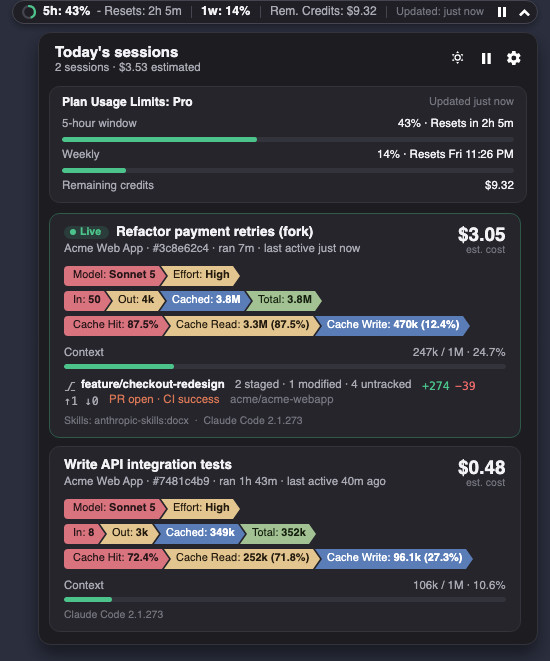

</div>

---

## 🤔 Why

Checking what Claude has cost you means stopping what you're doing and opening **Settings → Usage**. Hand Claude
a long task, switch to other work, and you keep going back just to look at the meter.

Sticky AI Usage keeps that number next to your clock instead — and it never spends a cent of your budget to
show it.

## ✨ What you see

|  | |
|---|---|
| 📊 **Your real limits** | Monthly spend against your cap, or your Pro/Max 5-hour and weekly windows with the exact reset times |
| 🧠 **Knows your plan** | It works out how your account is billed and picks the right layout. Nothing to set up |
| 🪟 **Out of the way** | Compact inside the taskbar or menu bar, full size when you drag it out, pause it with one click |
| 🗂️ **Today's work** | One click lists every Claude Code session from today with its cost, tokens, context and git state |
| 🧩 **Your layout** | 49 fields, drag and drop, eight colors, live preview |
| 🌗 **Light and dark** | Follows your computer, or pin either one |
| 🔒 **Private** | Everything stays on your machine. No telemetry, no accounts, no model calls |

## 🧭 Your plan, detected for you

Claude bills in two different ways, and the useful number is different for each. Sticky AI Usage works out which
one you're on and shows the right thing — and follows along if your plan changes.

### 💳 Monthly credit cap (Enterprise and credit plans)

<table>
  <tr>
    <td align="center" width="50%">
      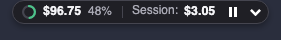<br/>
      <sub>Spend, share of the cap, and what this session has cost.</sub>
    </td>
    <td align="center" width="50%">
      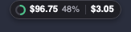<br/>
      <sub>Docked in the bar, the labels drop and the numbers stay.</sub>
    </td>
  </tr>
  <tr>
    <td align="center" colspan="2">
      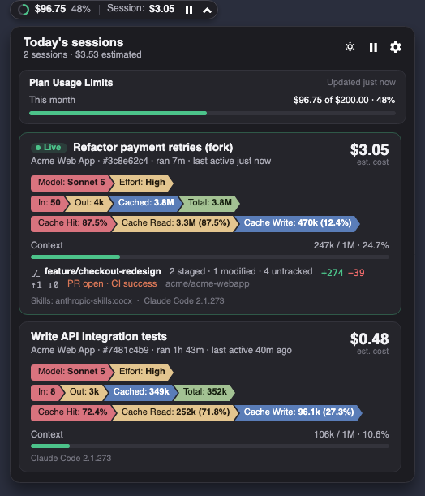<br/>
      <sub>Open it for the month as a bar — and today's sessions underneath. The ring turns yellow, orange then red as you approach the cap.</sub>
    </td>
  </tr>
</table>

### 🔁 Pro / Max plan limits

<table>
  <tr>
    <td align="center" width="50%">
      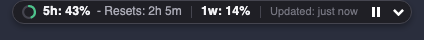<br/>
      <sub>Your 5-hour window, when it resets, your week, and how fresh the reading is.</sub>
    </td>
    <td align="center" width="50%">
      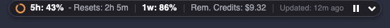<br/>
      <sub>Extra-usage credits when your account has them.</sub>
    </td>
  </tr>
  <tr>
    <td align="center" colspan="2">
      <br/>
      <sub>Both windows as bars, with the weekly reset as a day and time.</sub>
    </td>
  </tr>
</table>

## 🪟 Docked or free

Docked in the taskbar or menu bar it wears a compact form that fits the space; drag it onto the desktop and the
full readout comes back. It remembers where you left it.

<div align="center">
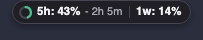&nbsp;&nbsp;
</div>

## 🌗 Light and dark

The whole app follows your computer's appearance and switches with it. The sun/moon button in the panel pins
either one whenever you want.

<table>
  <tr>
    <td align="center" width="50%">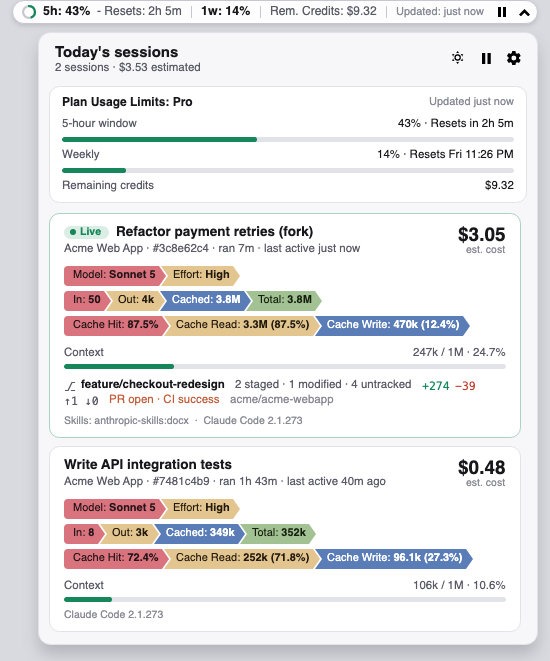<br/><sub>Light</sub></td>
    <td align="center" width="50%"><br/><sub>Dark</sub></td>
  </tr>
</table>

## 🧩 Make the card yours

**Settings → Session cards → Customize** opens full screen: 49 fields on the left, your card on the right, and a
live preview of the real thing underneath.

<div align="center">
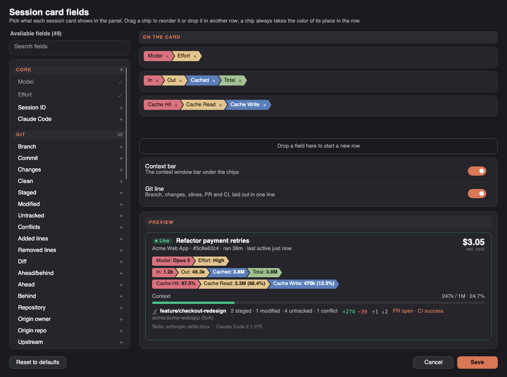
</div>

- **Click a field** and it lands beside the others of its kind — model with model, git with git.
- **Drag any chip** into any row, or onto the strip at the bottom to start a new one.
- **Colors follow position,** so a chip takes its new slot's color the moment you drop it.
- **Eight to a row.** Rows with room light up while you drag, and nothing is ever silently dropped.

## 📸 More screenshots

### macOS

<table>
  <tr>
    <td align="center" width="50%">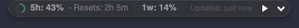<br/><sub><b>Paused.</b> Dimmed, with a play button.</sub></td>
    <td align="center" width="50%"><br/><sub><b>Signed out.</b> It says so, and picks up your new sign-in by itself.</sub></td>
  </tr>
  <tr>
    <td align="center" width="50%">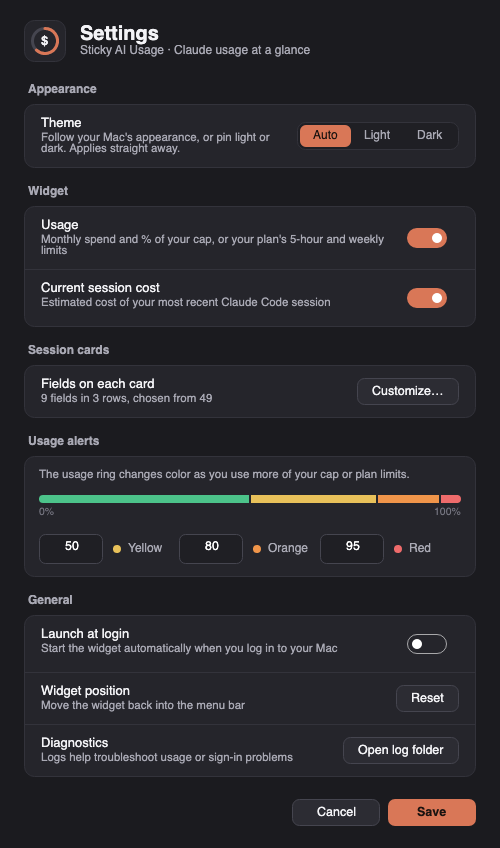<br/><sub><b>Settings.</b></sub></td>
    <td align="center" width="50%">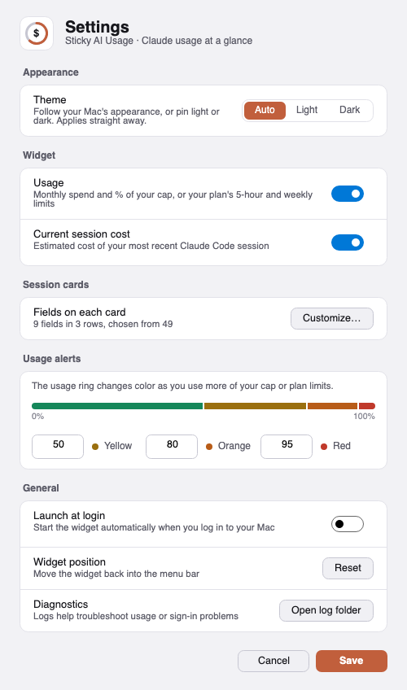<br/><sub><b>The same, light.</b></sub></td>
  </tr>
</table>

### Windows 11

<table>
  <tr>
    <td align="center" width="50%">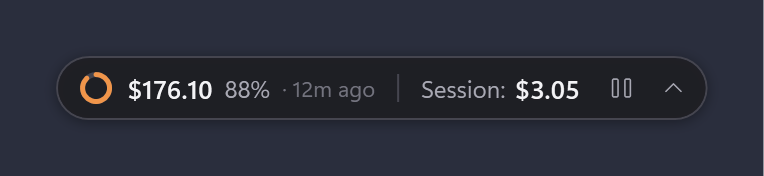<br/><sub><b>Approaching the cap.</b> Orange at 80%.</sub></td>
    <td align="center" width="50%">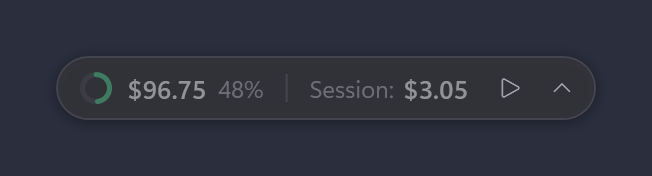<br/><sub><b>Paused.</b></sub></td>
  </tr>
</table>

## 🚀 Install

**You'll need:** Windows 11 or macOS 12+ (Apple Silicon or Intel), and to be signed in to **Claude Desktop** or
**Claude Code**. Nothing else — the downloads run as they are.

**First, read [Before you install](#-before-you-install)** — it explains how the widget uses your Claude sign-in.

1. Get the latest build from the **[Releases page](https://github.com/mohammad-k-shah/stickyAIusage/releases)**:
   - **macOS (Apple Silicon)**: [`StickyAIusage-mac-apple-silicon.zip`](https://github.com/mohammad-k-shah/stickyAIusage/releases/latest/download/StickyAIusage-mac-apple-silicon.zip)
   - **macOS (Intel)**: [`StickyAIusage-mac-intel.zip`](https://github.com/mohammad-k-shah/stickyAIusage/releases/latest/download/StickyAIusage-mac-intel.zip)
   - **Windows 11**: [`StickyAIusage-win-x64.zip`](https://github.com/mohammad-k-shah/stickyAIusage/releases/latest/download/StickyAIusage-win-x64.zip)
2. Unzip it.
   - **macOS**: drag **Sticky AI Usage** to your Applications folder and open it. It isn't notarized yet, so macOS
     blocks the first launch: go to **System Settings → Privacy & Security**, scroll down and click
     **Open Anyway**. (On macOS 14 and earlier, right-click the app → **Open** → **Open** also works.)
   - **Windows**: put the folder wherever you like and run `StickyAIusage.exe`. It isn't code-signed yet, so if
     Windows shows *"Windows protected your PC"*, click **More info → Run anyway**.
3. **macOS**: the widget appears in your menu bar, left of your status icons. **Windows**: next to your tray icons.
4. Click it for today's sessions; drag it anywhere you prefer; the gear opens Settings.
5. Turn on **Launch at login** / **Start with Windows** in Settings and forget about it.

<details>
<summary>Prefer to build it yourself?</summary>

```bash
git clone https://github.com/mohammad-k-shah/stickyAIusage.git
cd stickyAIusage

# macOS
scripts/build-mac-app.sh            # add osx-x64 for Intel Macs
open "artifacts/mac/Sticky AI Usage.app"

# Windows (needs the .NET 8 SDK)
dotnet run --project src\StickyAIusage\StickyAIusage.csproj
```
</details>

> [!NOTE]
> Only one copy runs at a time — launching it again while it's running does nothing.

## ⚙️ Settings

| Setting | What it does |
|---|---|
| **Theme** | Follow your computer, or pin Light or Dark |
| **Usage** | Show your monthly spend, or your plan's 5-hour and weekly limits |
| **Current session cost** | Show what the session you're working in has cost |
| **Fields on each card** | Opens the customizer: which of the 49 fields a session card shows, and in what order |
| **Usage alerts** | The points where the ring turns yellow, orange and red (50 / 80 / 95 % out of the box) |
| **Launch at login** | Start the widget when you sign in |
| **Widget position** | Put it back next to the clock if you've lost it |

## 🔒 Privacy, and what it touches

- **It never uses your budget.** Reading your usage costs nothing against it, and it never calls a model.
- **No telemetry, no account, no sign-up.** Nothing is sent to the author or any third party.
- **What it reads on your computer:** Claude Code's session transcripts (`~/.claude/projects`), and the Claude
  sign-in that Claude Code already saved — `~/.claude/.credentials.json` on Windows, the
  *Claude Code-credentials* Keychain item on macOS. Session details never leave your machine.
- **What it changes:** when that sign-in token is about to expire, it renews it the same way Claude Code does
  and saves the new token back to the same place, so neither the widget nor Claude Code is left holding an
  expired one. It changes nothing else there.
- **Who it talks to:** `api.anthropic.com` for your usage numbers and `console.anthropic.com` to renew the
  sign-in token, both with your own Claude sign-in. If the GitHub CLI (`gh`) is installed and signed in, it
  also asks GitHub for the pull request and CI status of the repositories your sessions are in - [Before you install](#-before-you-install).

## 🩺 Troubleshooting

| You see | What to do |
|---|---|
| **Sign in to Claude** | Your Claude sign-in expired. Open Claude Desktop or run `claude` once — the widget picks it up. |
| **Usage unavailable** | Claude's usage service couldn't be reached. It keeps retrying on its own. |
| `Updated: 12m ago` | Usage checks are being throttled. It resumes by itself. |
| A session is missing | Sessions where nothing happened (no cost) are hidden on purpose. |
| The widget is off-screen | Settings → **Widget position** → **Reset**. |

## 🗺️ What's next

- [x] macOS app
- [x] Pro / Max plans: 5-hour and weekly limits, credits
- [x] Light theme that follows your computer
- [x] Session cards you can customize
- [ ] Signed and notarized downloads, and a Windows installer
- [ ] Other AI tools behind the same widget: GitHub Copilot, OpenAI Codex, ChatGPT
- [ ] Multi-monitor and taskbars that aren't at the bottom

## 🔑 Before you install

 **Sticky AI Usage uses your Claude sign-in.** Please read this
 before you install it.

 To show your live usage, it uses the sign-in Claude Code already saved on your computer:

 - **It reads Claude Code's sign-in token** and uses it to ask Anthropic for your usage numbers.
 - **It renews that token** when it's about to expire, the same way Claude Code does, and **saves the new token
   back** where Claude Code keeps it. Because both apps renew the same sign-in, an unlucky overlap can
   occasionally leave Claude Code asking you to sign in again; signing in fixes it.

 What it never does: call a model, spend your budget, or send anything to anyone except Anthropic (and GitHub,
 if you use the `gh` CLI) - [Privacy, and what it touches](#-privacy-and-what-it-touches).

## 🤝 Contributing

Issues and pull requests are very welcome — bug reports, ideas, a new field for the session card, or a plan
layout that doesn't look right on your account.

`main` holds released code only; all changes go through the **`develop`** branch:

1. **Fork** this repository.
2. Clone your fork and create a branch from the latest **`develop`**:
   `git checkout -b feature/my-change upstream/develop` (setup in [docs/CONTRIBUTING.md](docs/CONTRIBUTING.md)).
3. Make your change, **add unit tests for any code change**, and run them: `dotnet test tests/StickyAIusage.Tests`
4. Commit, then push your branch to your fork: `git push -u origin feature/my-change`
5. Open a **pull request** into **`develop`** (not `main`) and describe what changed and why.

Merged changes ship in the next release: bug fixes and small improvements as a minor or patch version, big new
features as a major version. Every contributor is credited on the release page. Details, code layout and build
steps: [docs/CONTRIBUTING.md](docs/CONTRIBUTING.md).

## ⭐ If this saves you a trip to Settings → Usage

- **Star the repo** — it's the signal that decides whether this keeps getting built.
- **Fork it** and make it yours.

## 🙏 Thanks

- The open-source Claude status line projects that showed how much of this is possible.
- Everyone who tried an early build and said what was wrong with it.
- Made to work with Anthropic's [Claude Desktop and Claude Code](https://claude.com/download).

## 📄 License

[MIT](LICENSE) © 2026 Mohammad Karimulla Shah

Sticky AI Usage is an independent project. It isn't affiliated with, endorsed by or supported by Anthropic.
Claude, Claude Code and Claude Desktop are trademarks of Anthropic.

<div align="center">

<br/>

**Never leave your work to check the meter again.**<br/>
⭐ [Star](https://github.com/mohammad-k-shah/stickyAIusage) · 🍴 [Fork](https://github.com/mohammad-k-shah/stickyAIusage/fork)

</div>
