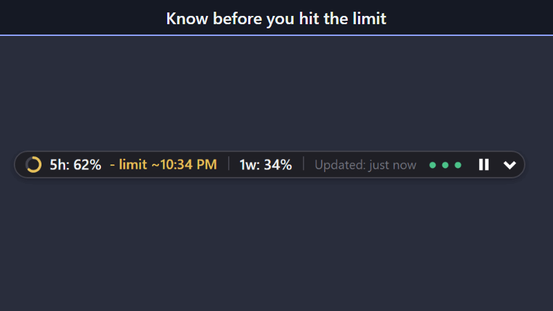
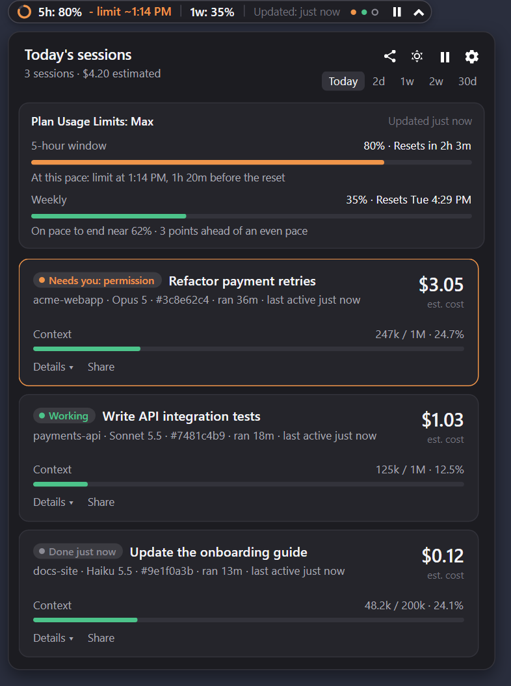
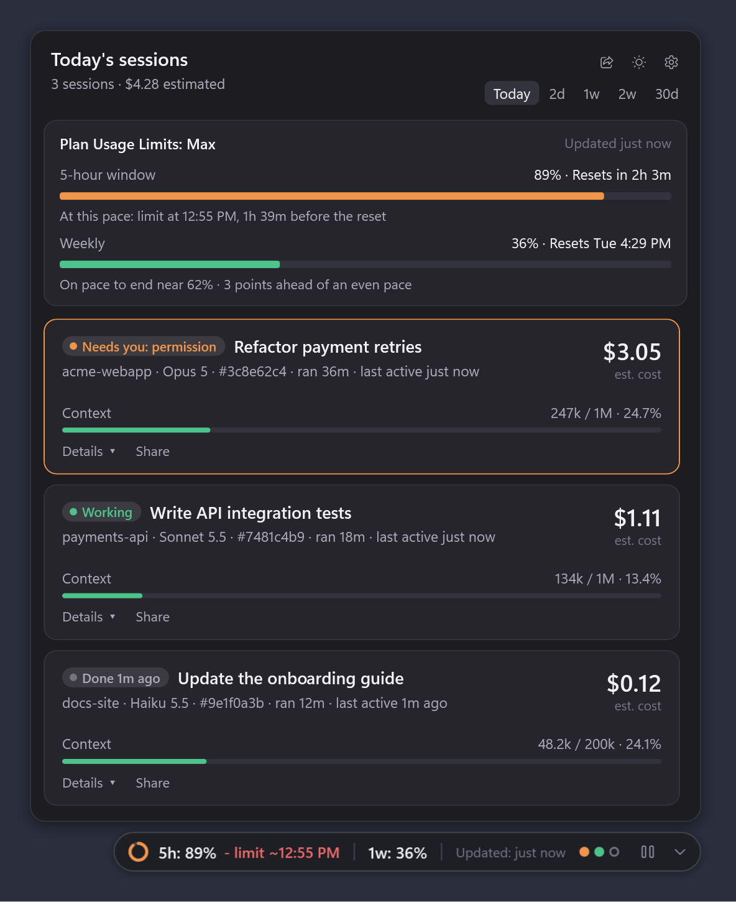
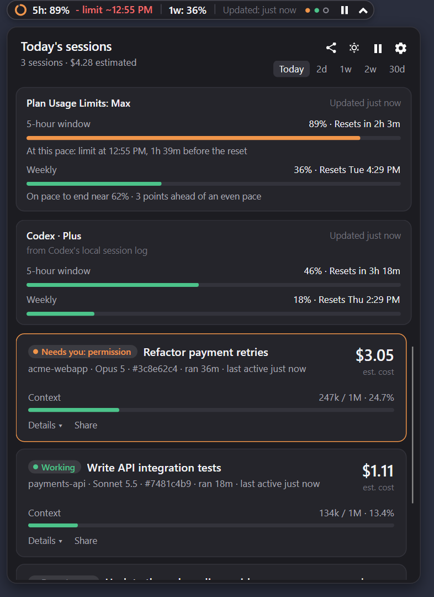
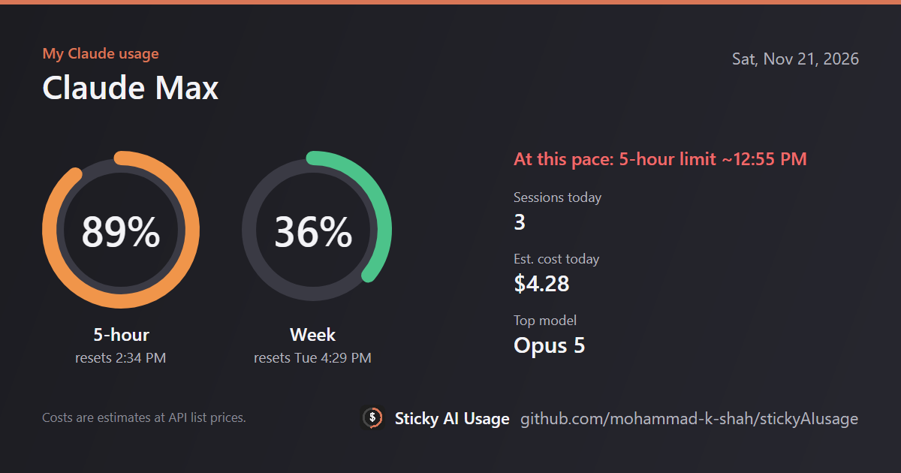

<div align="center">


# Sticky AI Usage

**在触顶之前就知道。**<br/>
在 Windows 任务栏或 Mac 菜单栏中显示你的 Claude Code 用量上限、按当前速度会在何时触顶，以及哪个会话正在等你——数据直接来自 Claude Code 本身。

[English](README.md) · **简体中文** · [日本語](README.ja.md) · [한국어](README.ko.md)

<sub>这是翻译版本，以 2026-11-23 的英文 README 为准；如有出入，以[英文 README](README.md) 为参考。欢迎母语使用者指正。</sub>

⭐ **如果它帮你避免了一次被限额卡住的会话，请点个 Star。**

<sub>独立的开源项目——与 Anthropic 无关联，也未获其背书。</sub>

<br/>



</div>

**一行命令安装**（详细说明和其他方式见英文 README 的 [Install](README.md#-install)）：

```text
Windows   irm https://raw.githubusercontent.com/mohammad-k-shah/stickyAIusage/main/scripts/install.ps1 | iex
macOS     curl -fsSL https://raw.githubusercontent.com/mohammad-k-shah/stickyAIusage/main/scripts/install.sh | sh
Plugin    /plugin install sticky-usage --marketplace mohammad-k-shah/stickyAIusage      （在 Claude Code 中）
```

首次启动时，小组件会主动帮你连接插件：如果电脑上有 Claude Code 命令行，只需点一下；否则复制一行命令粘贴即可。

<p align="center"></p>

---

## ⏱️ 在触顶之前就知道

小组件始终显示你的 5 小时窗口和每周窗口（或每月消费上限）。你工作时，它会观察用量增长的速度：如果按当前速度 5 小时上限会在重置之前到来，倒计时就会变成预计触顶的时间，例如 "limit ~1:36 PM"，一小时内变橙色，30 分钟内变红色。当某个窗口变橙或变红、距离上限还有 30 分钟、已经触顶，以及窗口重置时（"You're back"），各发送一次通知。同一条通知不会重复；支持免打扰时段和一小时静音。

<p align="center"></p>

## 🚦 知道哪个代理在等你

每个正在运行的 Claude Code 会话都会在小组件上有一个圆点：等你操作时（权限请求、问题、MCP 服务器的输入）为**琥珀色**，工作中为**绿色**，完成后为**灰色**。如果某个会话已等待 20 秒，会发一条通知告诉你是哪一个。面板中等待的会话排在最前面。

<p align="center"></p>

## 🤝 也让代理知道

同一个插件在 Claude Code 内部也能使用，有没有小组件都可以：`/pace` 命令、接近上限时提示框上方的一行信息、Claude 在长时间或并行工作前会调用的工具，以及一个预算守卫——在接近上限时启动子代理之前询问一次（照常运行、改用 Haiku，或跳过）。

```text
/pace
5-hour: 43% used · resets 4:30 PM · at this pace: limit ~4:12 PM
Week:   14% used · resets Fri 3:30 PM · under an even pace
Session: context 24% · cost $3.05

● 5h 89% · limit ~3:27 PM · week 36%          ← 用量过半时显示在提示框上方
```

## 🔑 数据从哪里来


| 你看到的 | 来源 | 可信度 | 会离开你的电脑吗？ |
|---|---|---|---|
| 5 小时、每周和消费上限及其重置时间 | Claude Code 每次回答后交给插件的自身数据 | 官方（Claude Code 的公开接口） | 否 |
| 哪个会话在工作或在等待 | 经同一插件传来的 Claude Code 事件 | 官方 | 否 |
| 会话费用、token、上下文、模型 | 你电脑上的 Claude Code 会话文件（或经插件传来的 Claude Code 自身数据） | 推算（本地文件） | 否 |
| 按当前速度的触顶时间 | 在你的电脑上根据上述读数计算 | 估算，并会标明 | 否 |
| Codex 的上限（如果你使用 Codex） | 你电脑上 Codex 自己的会话日志 | 推算 | 否 |

**默认情况下，它从不读取你的 Claude 登录信息，也不发出任何网络请求。** 设置 → **Usage source** 中还有 **Automatic** 和 **Legacy** 两种模式：它们会读取 Claude Code 保存的登录信息并向 Anthropic 的用量服务查询（适合以美元计的每月消费上限和额度，插件不提供这些数据）；该服务并未对其他应用公开文档。这两种模式只读取该登录信息，从不续期或修改 Claude 的任何内容。从旧版本升级会保留 Automatic，以便原有数据继续显示；选择 **Plugin** 即可全部关闭。[Data sources](docs/DATA-SOURCES.md)（英文）列出了它读写的每个文件和可能发出的每个请求，以及如何逐项关闭。

## 📚 全部功能

|  | |
|---|---|
| 📊 **真实的用量上限** | 每月消费及其占上限的比例，或 Pro/Max 套餐的 5 小时和每周窗口，附带精确的重置时间 |
| ⏱️ **能撑到重置吗？** | 按当前速度告诉你何时会触及 5 小时上限（"limit ~4:12 PM"，临近时变红）、本周或本月会走到哪里，以及你是否快于均匀速度。这是估算，界面也会注明 |
| 🔔 **被卡住之前先提醒** | 窗口变橙或变红、按当前速度 30 分钟内将触顶、已经触顶，以及窗口重置时（"You're back"），各发一条安静的通知。同一条不会重复；支持免打扰时段和一小时静音 |
| 🚦 **哪个会话在等你** | 每个 Claude Code 会话在小组件上都有一个圆点：等待权限或回答时为琥珀色，工作中为绿色，完成后为灰色。会话等待 20 秒时发一条通知。悬停即可看到是哪个会话、在等什么 |
| 🔌 **直接来自 Claude Code** | 有了配套插件，Claude Code 每轮对话后都会亲自交出你的用量上限：不读取登录信息，不联网 |
| 🤝 **也支持 Codex** | 同时在用 OpenAI Codex？它的 5 小时和每周上限会在 Claude 下方显示为单独的卡片，数据来自你电脑上 Codex 自己的会话日志：不读取登录信息，不联网。当 Codex 更接近上限时，小组件会显示 "Codex 91%" |
| 💬 **在 Claude Code 里也能看** | 同一个插件提供 `/pace`、接近上限时提示框上方的一行信息，以及 Claude 在长时间或并行工作前会调用的工具。没有小组件也能用；有小组件时两边显示相同的触顶时间 |
| 🛡️ **子代理的安全带** | 接近上限时，在 Claude 启动子代理之前只问一次：照常运行、改用 Haiku，或跳过。每次扇出只问一次，`claude -p` 中从不询问 |
| 👋 **一分钟上手** | 首次启动会一步步引导：应用读取哪些内容、连接 Claude Code 插件（一键安装，或复制命令粘贴到 Claude Code），以及开机启动。**设置 → Health** 随时可以重新检查一切，告诉你如何处理异常，并能复制一份报告用于反馈问题 |
| 🧠 **自动识别你的套餐** | 它会判断你的账户如何计费，并选择合适的布局。无需任何设置 |
| 🪟 **不碍事** | 位于 Windows 任务栏内、托盘旁边（可选择显示器），或 Mac 菜单栏；拖到桌面则完整显示，并停在你放下的位置；演示或全屏观看时自动隐藏。一键暂停。空闲时 CPU 占用为 0%，即使磁盘上有 5,000 个会话记录 |
| 🗂️ **今天的工作** | 一键列出今天每个 Claude Code 会话的费用、token、上下文和 git 状态 |
| 💵 **按最新价格计算费用** | 会话费用按照 Anthropic 当前的价格表计算，价格表是一个任何人都能更新的数据文件；使用插件时，会话显示 Claude Code 自己报告的费用 |
| 📣 **分享出去** | 一键把今天的用量或某个会话（"this refactor cost $3.05"）变成一张设计好的图片放进剪贴板，直接粘贴到帖子里；12 月和 1 月还能生成你和 Claude Code 的全年回顾。除非你打开，否则不显示项目名称 |
| 🧩 **你的布局** | 数十个字段，拖放排列，八种颜色，实时预览 |
| 🌗 **浅色和深色** | 跟随系统，或固定其中一种 |
| 🔒 **私密** | 一切都留在你的电脑上。没有遥测，没有账户，不调用模型 |

<p align="center">&nbsp;&nbsp;</p>

## ❓ 常见问题

**为什么不直接用状态栏（status line）？** Claude Code 的状态栏只在你正在看的终端里。小组件在所有应用之上始终可见，支持 Claude Desktop 的 Code 标签页，一眼看到多个会话，能预测触顶时间并通知你。它也不会占用你的状态栏：插件在提示框上方显示自己的一行，从不修改你的 `statusLine` 设置。

**它会读取我的登录信息吗？** 默认不会：新安装只读取 Claude Code 交给插件的数据。只有在设置 → Usage source 中选择 **Automatic** 或 **Legacy** 时，才会读取 Claude Code 保存的登录信息（这两个选项旁边会注明）。

**它会消耗我的额度吗？** 不会。它从不调用模型；读取用量不占用你的限额。插件完全不发出网络请求。

**支持 Claude Desktop、VS Code 和 WSL 吗？** 插件在所有支持插件的 Claude Code 中运行：终端、Claude Desktop 的 Code 标签页和 VS Code 扩展。插件不会在 Claude Desktop 的 WSL 会话中加载；WSL 中的 Claude Code 把文件保存在 Linux 里，Windows 小组件不会去那里读取。

**企业版每月上限？** 以美元和占上限的百分比显示。插件只以百分比提供网关的消费上限；如需以美元显示的每月上限（以及额度），请在设置 → Usage source 中选择 **Legacy**。

**为什么 Windows 下载包这么大？** 标准下载包自带 .NET 运行时（压缩后约 66 MB），因此在任何 Windows 11 上都能运行。如果已安装 .NET 10 Desktop Runtime，`StickyAIusage-win-x64-small.zip` 是同一个应用，不到 1 MB。

**它与 Anthropic 有关联吗？** 没有。这是一个独立的开源项目，为配合 Claude Code 使用而开发。

---

更多内容（安装细节、插件、设置、隐私、故障排除、路线图、贡献、许可证）请见[英文 README](README.md)。路线图见 [docs/ROADMAP.md](docs/ROADMAP.md)，参与贡献见 [docs/CONTRIBUTING.md](docs/CONTRIBUTING.md)（均为英文）。
